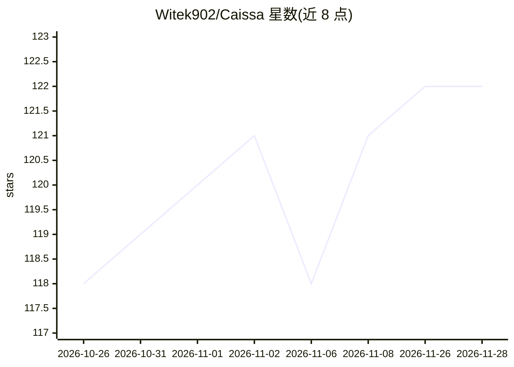

# Witek902/Caissa

⭐ 122 · C++ · MIT · 推送 2026-11-21 · [GitHub](https://github.com/Witek902/Caissa) · 个人维护

**UCI 兼容的 C++ 国际象棋引擎，NNUE 评估**

由 Michał Witanowski 自 2021 年起用 C++ 从零编写的 UCI 兼容国际象棋引擎，MIT 许可。采用自定义神经网络评估（在 205 亿自对弈局面上训练），支持常规棋、FRC 与 DFRC 变体，配合 Syzygy 残局库（至 7 子）。搜索实现包含 Negamax、PVS、多线程、MultiPV 等机制。用户可在 UCI 图形界面中运行，或按 CPU 指令集（AVX-512/BMI2/NEON 等）下载对应发行版二进制，或用 Makefile/CMake 自行编译；网络文件 .pnn 构建时自动下载。

## 筛选速览

| 维度 | 判定 | 备注 |
|---|---|---|
| AI 角色 | `ai-native` | 本体是模型或模型工具 |
| 许可风险 | `permissive` | MIT |
| 部署形态 | `desktop` | 安装包/桌面程序 |
| 模型依赖 | — | README 未给出锁定关系 |
| 硬件要求 | — | 无带数字的原话,不猜 |
| 安装摩擦 | `high` | 编译与系统依赖俱全 |
| 成熟度 | — | 结构信号不足 |

## 能力要点

- UCI 协议完整支持，可在任意 UCI 棋类 GUI 中运行
- 自定义 NNUE 风格神经网络评估，205 亿自对弈局面训练
- 支持 Syzygy 残局库（至 7 子）与 FRC/DFRC 变体
- 按 CPU 指令集提供多种二进制变体（AVX-512/BMI2/AVX2/NEON 等）

## 适用场景

- 在 UCI 棋类 GUI 中对弈或分析棋局
- 多线程分析多条变化线路（MultiPV）
- 加载不同 .pnn 网络文件测试评估强度
- 研究引擎搜索与 NNUE 推理实现

## 场景标签

 · 领域:游戏/棋类 AI

## 证据(README 行号)

> L13: **Caissa** is a strong, UCI-compatible chess engine written from scratch in C++ since early 2021 by Michał Witanows
> L55: - ✅ **UCI Protocol** — full Universal Chess Interface support
> L56: - ✅ **Neural Network Evaluation** — custom NNUE-style evaluation, see Neural Network

## 星数曲线

2026-10-26 118 → 2026-11-28 122（+4）

---
*卡片 v1 · prompt 1.4 · 生成 2026-11-28 · 置信度 high · 依据 README sha `a4834a67a6ae` · [字段定义](../../DATASET.md)*
