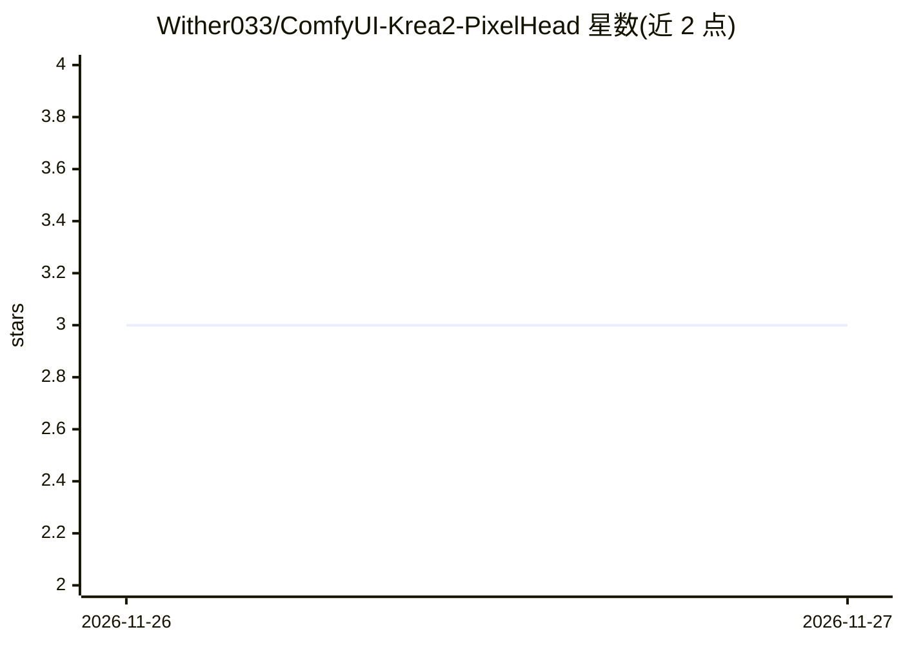

# Wither033/ComfyUI-Krea2-PixelHead

⭐ 3 · Python · MIT · 推送 2026-11-26 · [GitHub](https://github.com/Wither033/ComfyUI-Krea2-PixelHead) · [官网](https://huggingface.co/pocis/Krea-2-PixelHead) · 个人维护 · 中文 README

**ComfyUI 自定义节点：为 Krea-2 提供直接 RGB 像素解码头，替代 VAE 解码器**

遵循 FastFrames 论文方法的 ComfyUI 自定义节点：在最后采样步挂接 SingleStreamDiT 的 last.linear，提取 6144 维目标图像 token 与去噪 latent patch，用 27.49M 参数的 ConvNeXt + PixelShuffle 头解码为 RGB，替代 qwen_image_vae（WanVAE）3D 因果解码器。README 记载 768×768 下 NVIDIA L4 中位解码延迟 59.55 ms，峰值额外显存 <0.2 GB。限制：σ 范围限于 0.045–0.420 训练区间；依赖 DiT 最终步的实时特征，无法解码独立 .latent 文件。

## 筛选速览

| 维度 | 判定 | 备注 |
|---|---|---|
| AI 角色 | `ai-native` | 本体是模型或模型工具 |
| 许可风险 | `permissive` | MIT |
| 部署形态 | `None` |  |
| 模型依赖 | — | README 未给出锁定关系 |
| 硬件要求 | — | 无带数字的原话,不猜 |
| 安装摩擦 | `low` | 无编译、无系统依赖或容器化 |
| 成熟度 | — | 结构信号不足 |

## 能力要点

- 纯文生图流程无需运行 VAE 解码器
- 权重提供 BF16（52.6 MiB）与 FP32（104.9 MiB）两种 safetensors
- 兼容 krea2_turbo/krea2_raw、FP8/INT8/GGUF 量化及微调变体
- 支持文生图与风格/参考图条件生成（tap.py 动态切分 token）

## 适用场景

- 在 ComfyUI 的 Krea-2 文生图工作流中替换 VAE 解码环节
- 在 1024–2048px 采样中避免 VAE 的显存峰值
- 配合风格/参考图条件生成保持细部纹理与暗部过渡

## 场景标签

`图像生成` · 领域:内容生成

## 证据(README 行号)

> L3: Bridged direct RGB pixel readout head for **Krea-2** in ComfyUI, replacing the `242.0 MiB` 3D-causal `qwen_image_vae
> L11: Following *FastFrames* (`arXiv:2611.23226`), this node hooks `SingleStreamDiT`'s `last.linear` on the final samplin

## 星数曲线

2026-11-26 3 → 2026-11-27 3（+0）

---
*卡片 v1 · prompt 1.4 · 生成 2026-11-26 · 置信度 high · 依据 README sha `1f0f8168e859` · [字段定义](../../DATASET.md)*
