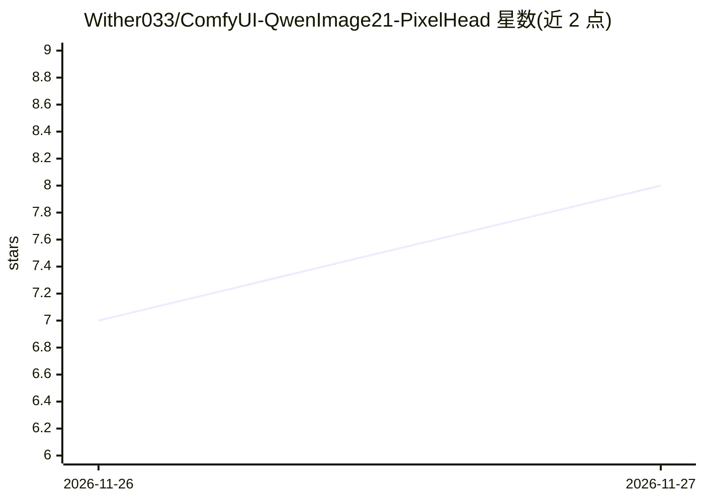

# Wither033/ComfyUI-QwenImage21-PixelHead

⭐ 8 · Python · MIT · 推送 2026-11-26 · [GitHub](https://github.com/Wither033/ComfyUI-QwenImage21-PixelHead) · [官网](https://huggingface.co/pocis/Qwen-Image-2.1-PixelHead) · 个人维护 · 中文 README

**ComfyUI 的 Qwen-Image 2.1 RGBA 像素直出解码头节点**

以 ComfyUI 自定义节点形式提供的模型实现：在 Qwen-Image 2.1 采样末端用轻量像素读取头（v0.3 二维 Haar 小波 / v0.1 快速 1x/2x）替代 644.2 MiB 的 WanVAE 解码器，输出 4 通道 RGBA（image_rgb/alpha_mask/image_rgba）。提供 79.3 MiB 与 48.8 MiB 等多档权重，支持 8 步 Turbo LoRA 与 20–35 步基础采样、文本到图像及多图参考编辑，含 2K/4K 平铺解码，解码后权重卸载回 CPU。README 附基准数据、示例工作流与局限说明（极端 1px 木刻纹理仍偏软）。

## 筛选速览

| 维度 | 判定 | 备注 |
|---|---|---|
| AI 角色 | `ai-native` | 本体是模型或模型工具 |
| 许可风险 | `permissive` | MIT |
| 部署形态 | `None` |  |
| 模型依赖 | — | README 未给出锁定关系 |
| 硬件要求 | — | 无带数字的原话,不猜 |
| 安装摩擦 | `low` | 无编译、无系统依赖或容器化 |
| 成熟度 | — | 结构信号不足 |

## 能力要点

- v0.3 Haar 小波读取头，权重 79.3 MiB，附基准延迟与 VRAM 峰值数据
- v0.1 提供 1x 与 2x（1024→2048）快速分支
- 支持 8 步 Turbo LoRA、多步基础采样与多图参考编辑
- 单加载节点自动识别 v0.3/v0.2/v0.1 检查点

## 适用场景

- 在 ComfyUI 中对 Qwen-Image 2.1 做免 VAE 快速解码出图
- 批量种子草稿时用 v0.1 快速分支降低解码延迟
- 需要 RGBA alpha 通道输出的图像生成管线

## 场景标签

`图像生成` · 领域:内容生成

## 证据(README 行号)

> L3: Direct RGBA pixel readout head (`v0.3` Haar Wavelet High-Fidelity & `v0.1` Fast `1x` / `2x`) for **Qwen-Image 2.1** 
> L26: - **No `644.2 MiB` VAE required during sampling/decode**: Avoids `VAEDecode` intermediate VRAM spikes (`1.9–7.5 GB`

## 星数曲线

2026-11-26 7 → 2026-11-27 8（+1）

---
*卡片 v1 · prompt 1.4 · 生成 2026-11-26 · 置信度 high · 依据 README sha `34b6422df198` · [字段定义](../../DATASET.md)*
