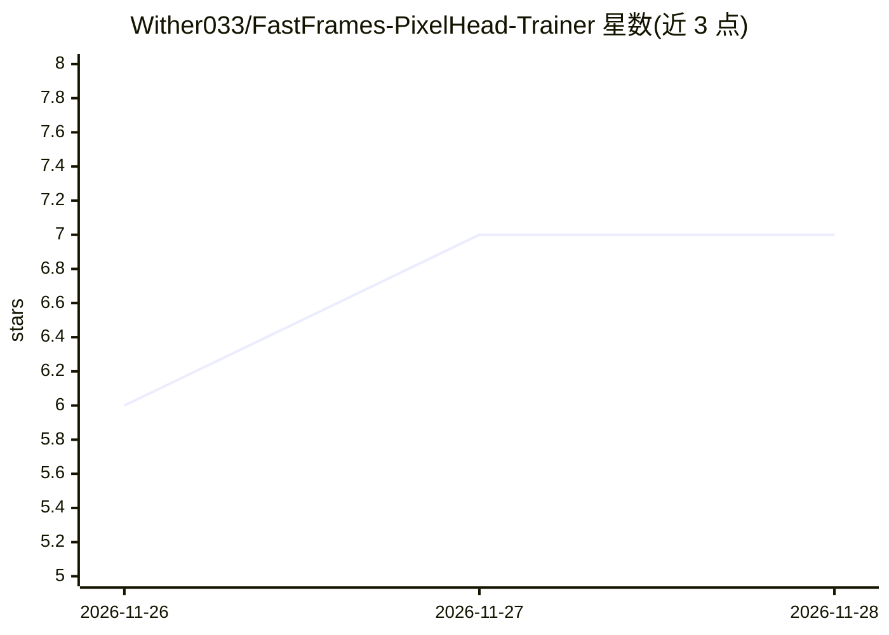

# Wither033/FastFrames-PixelHead-Trainer

⭐ 7 · Jupyter Notebook · MIT · 推送 2026-11-26 · [GitHub](https://github.com/Wither033/FastFrames-PixelHead-Trainer) · [官网](https://huggingface.co/collections/pocis/fastframes-zero-vae-direct-pixelheads-comfyui-6b031df8e9212f8bae294154) · 个人维护 · 中文 README

**为 ComfyUI 中 DiT 模型训练直接像素读取头的 PyTorch 工具包**

提供 MIT 许可的 PyTorch 训练库（pixelhead_trainer）、五个 DiT 骨干的 ComfyUI ModelPatcher hook 实现与单卡 Colab L4/A100 训练 notebook，用于在最终线性层之前 hook 隐藏态并训练替代 VAE 解码器的像素读取头。方法包含 post-AdaLN hook、CFG 线性组合、x0_hat_norm 融合、Haar 小波读出与 PatchGAN 高频损失；三阶段流水线先缓存潜变量再进行单步 Replay Buffer 蒸馏。已发布 Qwen-Image 2.1、Krea-2、MiniMax-H3 权重，FLUX.3-Klein 与 LTX-2.5 仅有脚本。

## 筛选速览

| 维度 | 判定 | 备注 |
|---|---|---|
| AI 角色 | `ai-native` | 本体是模型或模型工具 |
| 许可风险 | `permissive` | MIT |
| 部署形态 | `library` | 以包/库形式分发 |
| 模型依赖 | — | README 未给出锁定关系 |
| 硬件要求 | — | 无带数字的原话,不猜 |
| 安装摩擦 | `low` | 无编译、无系统依赖或容器化 |
| 成熟度 | — | 结构信号不足 |

## 能力要点

- 覆盖 2D 图像与 3D 视频 DiT 的五种骨干 hook 参考与训练脚本
- 三阶段 Colab 流水线：潜变量缓存、预检、单步 Replay Buffer 蒸馏（约 25–45 分钟）
- v0.3 采用 2D Haar 小波子带读出与高频 PatchGAN 损失
- 发布权重托管于 Hugging Face Collection，ComfyUI 节点按骨干分仓库提供

## 适用场景

- 为扩散模型的低延迟像素解码训练替代 VAE 的读取头
- 在 Colab L4 单卡上复现或适配新 DiT 骨干
- 在 ComfyUI 中接入已训练的 PixelHead 权重加速解码

## 场景标签

`模型训练` `微调` · 领域:训练与推理

## 证据(README 行号)

> L3: Training code, model-adaptation notes, and single-GPU Colab L4/A100 notebooks for building direct pixel readout head
> L14: Following the direct pixel readout formulation in *FastFrames: Video Generation at Interactive Latency* (`arXiv:261

## 星数曲线

2026-11-26 6 → 2026-11-28 7（+1）

---
*卡片 v1 · prompt 1.4 · 生成 2026-11-26 · 置信度 high · 依据 README sha `90ec45ebc0bd` · [字段定义](../../DATASET.md)*
