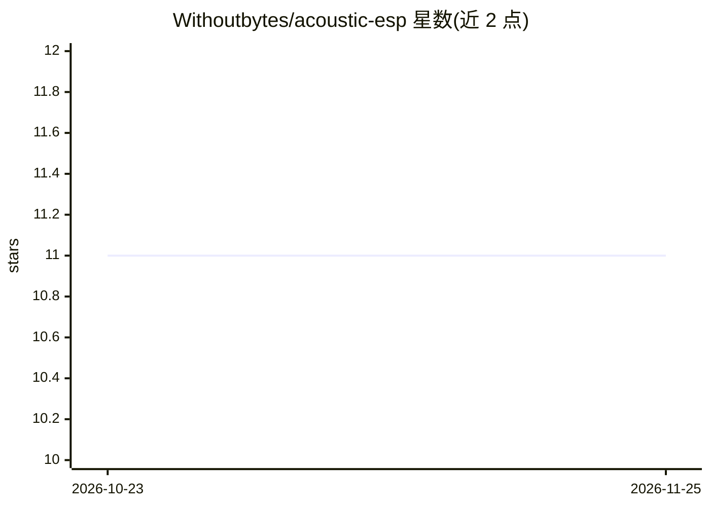

# Withoutbytes/acoustic-esp

⭐ 11 · Python · 推送 2026-04-26 · [GitHub](https://github.com/Withoutbytes/acoustic-esp) · 个人维护

**用机器学习从立体声脚步声估算方位的 FPS 游戏声学雷达工具**

通过虚拟声卡捕获游戏立体声音频，提取左右声道相关性、相位、频段能量等频域特征，训练 scikit-learn 分类器将特征映射到离散角度，并以声音强度估算相对距离，在雷达界面上显示方向标记。工作流为 collector.py 采集标注数据、train.py 训练模型、radar_ml.py 运行主雷达；另提供不依赖 ML 的多声道启发式变体 radar_surround.py。需 Python 3.10+ 和 7.1 音频设备（或 VB-Audio 虚拟声卡）。README 注明在线游戏中使用可能违反服务条款并导致封号。

## 筛选速览

| 维度 | 判定 | 备注 |
|---|---|---|
| AI 角色 | `ai-native` | 本体是模型或模型工具 |
| 许可风险 | `none` | — |
| 部署形态 | `desktop` | 安装包/桌面程序 |
| 模型依赖 | — | README 未给出锁定关系 |
| 硬件要求 | — | 无带数字的原话,不猜 |
| 安装摩擦 | `low` | 无编译、无系统依赖或容器化 |
| 成熟度 | — | 结构信号不足 |

## 能力要点

- 立体声 + scikit-learn 分类器估算 8 个离散角度（0°-315°）
- 三步工作流：采集标注（collector.py）→ 训练（train.py）→ 运行雷达（radar_ml.py）
- 无需读取游戏内存，仅从捕获的音频信号工作
- 提供不依赖 ML 的 5.1/7.1 多声道启发式雷达变体

## 适用场景

- 在 FPS 游戏中通过脚步声方位获得雷达提示
- 基于 HRTF 立体声信号做声源方向估计实验
- 学习音频特征工程与 scikit-learn 分类器的训练流程

## 场景标签

`数据分析` · 领域:效率与自动化

## 证据(README 行号)

> L28: **Acoustic radar** project: estimate **direction (angle)** and **relative distance** to the player from captured au
> L36: 3. Train a **scikit-learn** classifier to map those features to discrete **angles** (0°, 45°, …, 315°), using **int

## 星数曲线

2026-10-23 11 → 2026-11-25 11（+0）

---
*卡片 v1 · prompt 1.4 · 生成 2026-11-18 · 置信度 high · 依据 README sha `c68f18b73fea` · [字段定义](../../DATASET.md)*
