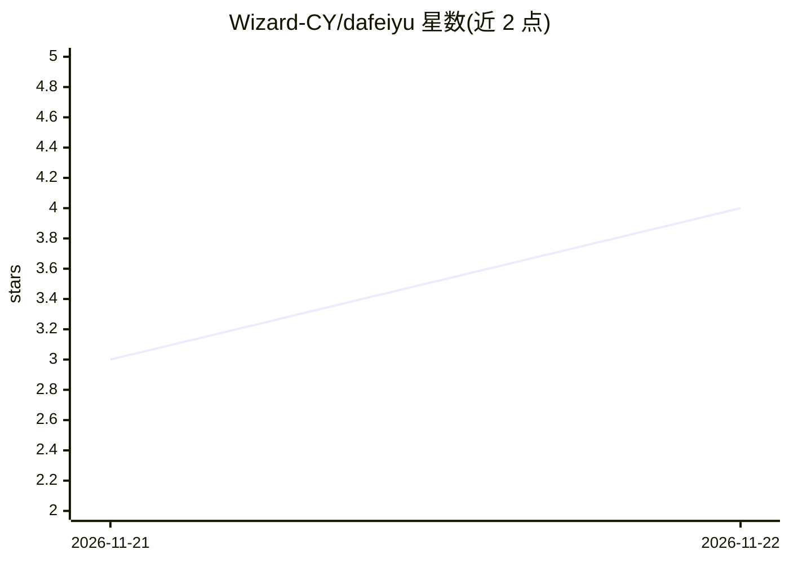

# Wizard-CY/dafeiyu

⭐ 4 · Python · AGPL-3.0 · 推送 2026-11-19 · [GitHub](https://github.com/Wizard-CY/dafeiyu) · [官网](https://github.com/Wizard-CY/dafeiyu/releases/latest) · 个人维护 · 中文 README

**跑在 QQ 上的自托管 AI 聊天角色整合包**

基于 AstrBot 与 NapCat（OneBot v11）把 LLM 接入 QQ 的自托管聊天角色：私聊/群聊对话、按概率接话、独立记忆与每日 22:00 提炼、表情包/语音条/点歌、定时发空间动态并回评。Windows 10/11 x64 一键包在 Releases，含 18 个 dafeiyu_* 插件与控制中心托盘。限制：QQ 必须锁定 9.9.36，程序登录有封号风险，API Key 产生费用，作者声明为个人随缘维护项目。

## 筛选速览

| 维度 | 判定 | 备注 |
|---|---|---|
| AI 角色 | `ai-native` | 本体是模型或模型工具 |
| 许可风险 | `viral` | AGPL-3.0 |
| 部署形态 | `None` |  |
| 模型依赖 | locked-api |  |
| 硬件要求 | — | 无带数字的原话,不猜 |
| 安装摩擦 | `medium` | 含编译或系统依赖之一 |
| 成熟度 | — | 结构信号不足 |

## 能力要点

- 私聊/群聊独立记忆，每日定时提炼再备份
- 18 个插件源码开放，人设写在 assets/persona.md 可改
- 控制中心托盘：看状态、改额度、给群放权、备份
- 提供 diagnose.cmd 生成诊断报告辅助排障

## 适用场景

- 给机器人小号搭一个会接梗吐槽的 QQ 聊天角色
- 在自己电脑上自托管 AI 陪伴，控制额度与群权限
- 修改 plugins/ 下的插件源码定制行为与人设

## 场景标签

`聊天机器人` · 领域:对话与助手

## 证据(README 行号)

> L7: > **English** — DaFeiYu is a self-hosted AI companion that lives in QQ. Built on AstrBot + NapCat (OneBot v11), powe
> L17: 她不是客服，也不是通用助手。会接梗、会吐槽、会装死；人设、口头禅和边界都写在 `assets/persona.md`，你可以改成自己的。

## 星数曲线

2026-11-21 3 → 2026-11-22 4（+1）

---
*卡片 v1 · prompt 1.4 · 生成 2026-11-22 · 置信度 high · 依据 README sha `466d390883af` · [字段定义](../../DATASET.md)*
