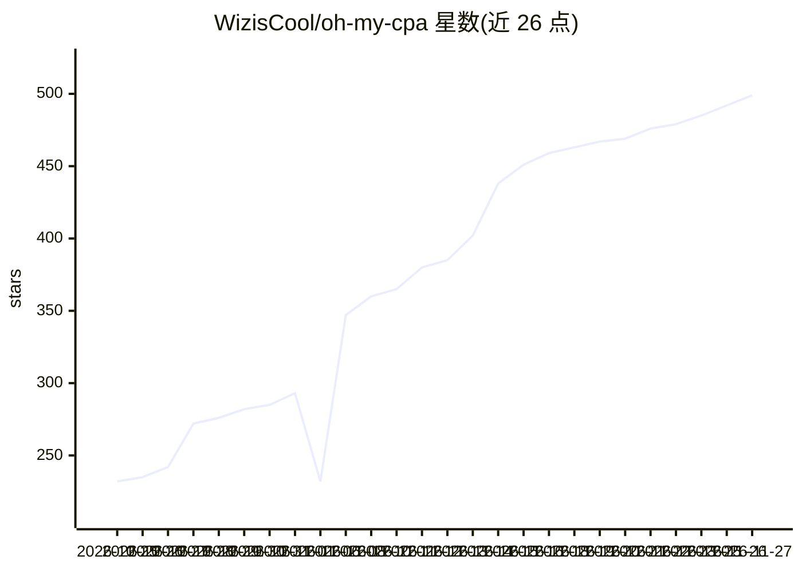

# WizisCool/oh-my-cpa

⭐ 499 · TypeScript · MIT · 推送 2026-11-26 · [GitHub](https://github.com/WizisCool/oh-my-cpa) · [官网](https://omc.junze.dev) · 个人维护 · 中文 README

**给 CLIProxyAPI 用户的自托管 Web 管理与观测控制台**

面向 CLIProxyAPI v8+ 的自托管 Web 控制台与观测层，基于 shadcn/ui 构建，提供桌面与移动端布局。集中管理 provider、OAuth 账户与可视化路由，实时记录请求的延迟、token 与费用，基于 OpenRouter 价目表做计价与 30 天消费统计，内置对话式 Agent 与 MCP 工作流。安全机制包括 AES-GCM 加密、审计日志与写前配置备份。单二进制（内嵌 React SPA + Go 控制面 + SQLite WAL），支持 Docker Compose、独立原生二进制或旁挂已有 CPA 实例部署。

## 筛选速览

| 维度 | 判定 | 备注 |
|---|---|---|
| AI 角色 | `ai-ecosystem` | LLM/agent 周边工具 |
| 许可风险 | `permissive` | MIT |
| 部署形态 | `self-host` | docker 或自建部署 |
| 模型依赖 | — | README 未给出锁定关系 |
| 硬件要求 | — | 无带数字的原话,不猜 |
| 安装摩擦 | `low` | 无编译、无系统依赖或容器化 |
| 成熟度 | — | 结构信号不足 |

## 能力要点

- 集中管理 provider、OAuth 账户与可视化路由
- 请求级延迟/token/费用记录与多维用量分析
- OpenRouter 价目匹配、通道倍率与 11 种显示货币
- 内置对话式 Agent，经人工批准的能力操作控制台

## 适用场景

- 统一管理 CLIProxyAPI 的多个 LLM provider 与 OAuth 账户
- 跟踪每个请求的模型用量、配额与费用
- 按模型/provider/key 分析流量趋势与 30 天开销

## 场景标签

`LLM 可观测性` · 领域:评测与运维

## 证据(README 行号)

> L30: **Oh My CPA** (OMC) is a self-hosted web console and observability layer for
> L102: - **Gateway & Routing**: Manage Codex, Claude, Gemini, Meta Muse, xAI, Vertex AI, DeepSeek, and OpenAI-compatible 
> L112:                                                  └─ Usage collector ──▶ CLIProxyAPI (:8317)

## 星数曲线

2026-10-25 232 → 2026-11-27 499（+267）

---
*卡片 v1 · prompt 1.4 · 生成 2026-11-25 · 置信度 high · 依据 README sha `42d91005fecb` · [字段定义](../../DATASET.md)*
