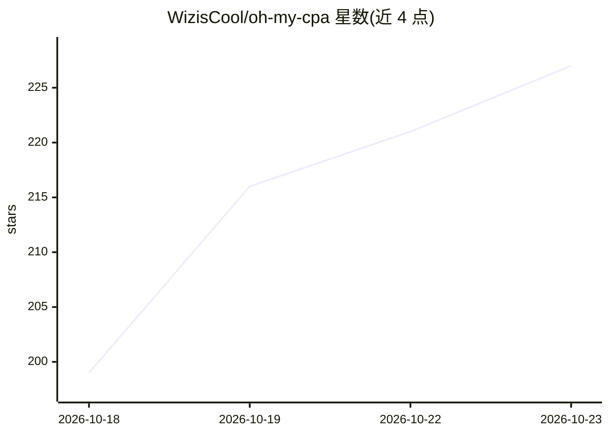

# WizisCool/oh-my-cpa

⭐ 227 · Go · MIT · 推送 2026-10-22 · [GitHub](https://github.com/WizisCool/oh-my-cpa) · [官网](https://omc-demo.junze.dev) · 个人维护 · 中文 README

**CLIProxyAPI 网关的自托管管理与用量观测控制台**

面向 CLIProxyAPI (CPA) 这一 API 网关的 Web 控制台：管理上游 AI 提供商、OAuth 凭据、客户端密钥与配置，并记录每个请求的用量与成本。形态为单个 Go 二进制（内嵌 React 控制台与本地 SQLite），离线运行，以 CPA 管理密钥登录。提供 Docker Compose 与多平台原生可执行文件两种安装方式；内置 OpenRouter 价格簿、请求记录检索、审计日志与 MCP/agent 页面（变更需控制台内确认）。CPA 需单独安装，数据库由 OMCPA_MASTER_KEY 加密，丢失后数据不可读。

## 筛选速览

| 维度 | 判定 | 备注 |
|---|---|---|
| AI 角色 | `ai-ecosystem` | LLM/agent 周边工具 |
| 许可风险 | `permissive` | MIT |
| 部署形态 | `self-host` | docker 或自建部署 |
| 模型依赖 | — | README 未给出锁定关系 |
| 硬件要求 | — | 无带数字的原话,不猜 |
| 安装摩擦 | `low` | 无编译、无系统依赖或容器化 |
| 成熟度 | — | 结构信号不足 |

## 能力要点

- 管理 CPA 的提供商、OAuth 凭据、客户端密钥与双模式配置编辑（表单/Monaco YAML）
- 请求级用量与成本观测：仪表盘、实时路由面板、请求记录与全文检索
- 基于 OpenRouter 价格簿的成本核算，含请求时不可变价格快照与渠道倍率
- 凭据与原始用量数据 AES-GCM 静态加密，敏感操作写入只增审计日志

## 适用场景

- 自托管 CLIProxyAPI 后用 Web 界面管理提供商与凭据
- 追踪网关的请求量、token 吞吐、缓存命中率与成本
- 按模型/渠道核算 LLM 调用费用并导出审计记录

## 场景标签

`LLM 可观测性` · 领域:评测与运维

## 证据(README 行号)

> L30: CLIProxyAPI (CPA) is an API gateway: it
> L31: adapts protocols, holds credentials and proxies requests. **Oh My CPA** (OMC) is a web
> L32: console for it. OMC manages the gateway's providers, credentials and configuration, and

## 星数曲线

2026-10-18 199 → 2026-10-23 227（+28）

---
*卡片 v1 · prompt 1.4 · 生成 2026-10-22 · 置信度 high · 依据 README sha `6d6ce45d9c7e` · [字段定义](../../DATASET.md)*
