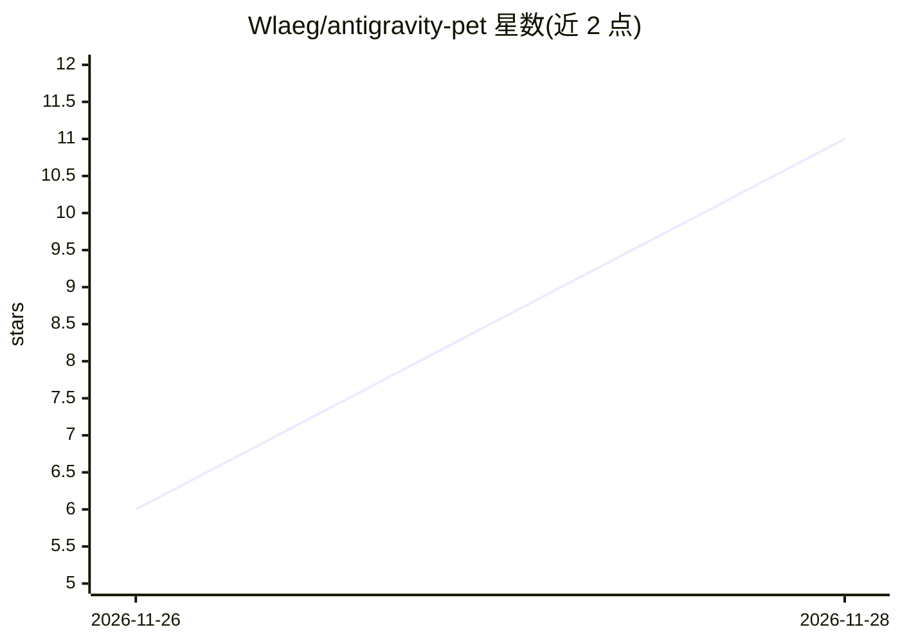

# Wlaeg/antigravity-pet

⭐ 11 · HTML · MIT · 推送 2026-11-27 · [GitHub](https://github.com/Wlaeg/antigravity-pet) · [官网](https://github.com/Wlaeg/antigravity-pet) · 个人维护 · 中文 README

**Google Antigravity 桌面像素宠物插件，实时显示 agent 任务状态**

为 Google Antigravity 设计的 Windows/macOS 桌宠插件，通过 hooks.json 接入 Antigravity 生命周期事件，按优先级显示多会话状态（Needs Input/Blocked/Ready/Running/Idle），支持气泡内审批高危命令、双击反向派活。内置 8 款像素角色，支持 1 张图片孵化自定义宠物、社区宠物包、11 种语言界面与 GitHub Releases 自更新。Windows 端用系统自带 csc.exe 编译，macOS 端用 swiftc 编译，无第三方运行时依赖。

## 筛选速览

| 维度 | 判定 | 备注 |
|---|---|---|
| AI 角色 | `ai-enhanced` | 去掉 AI 部分产品仍成立 |
| 许可风险 | `permissive` | MIT |
| 部署形态 | `desktop` | 安装包/桌面程序 |
| 模型依赖 | — | README 未给出锁定关系 |
| 硬件要求 | — | 无带数字的原话,不猜 |
| 安装摩擦 | `low` | 无编译、无系统依赖或容器化 |
| 成熟度 | — | 结构信号不足 |

## 能力要点

- 通过 hooks.json 接入 Antigravity 生命周期，多会话状态按优先级仲裁显示
- 气泡内 ✓允许/✕拒绝 审批按钮，双击桌宠向 Antigravity 派活
- 内置 8 款像素角色，1 张图即可经 hatch-pet 技能孵化自定义宠物
- 11 种语言本地化与 GitHub Releases 一键自更新

## 适用场景

- 后台运行 Antigravity 任务时通过桌宠获知状态变化
- 在桌宠气泡里直接批准或拒绝 agent 的高危命令
- 用自定义图片生成专属像素桌宠

## 场景标签

 · 领域:桌面工具/开发辅助

## 证据(README 行号)

> L5: **A native Windows & macOS pixel desktop companion plugin for Google Antigravity — zero third-party runtime dependen
> L18: **Antigravity Pet** brings a lightweight, reactive pixel-art companion directly to your Windows & macOS desktop whi
> L63: |**4**|`Running`|Thinking, file edits, commands (`PreInvocation` / `PostToolUse`)|Cyan halo + busy working animatio

## 星数曲线

2026-11-26 6 → 2026-11-28 11（+5）

---
*卡片 v1 · prompt 1.4 · 生成 2026-11-26 · 置信度 high · 依据 README sha `232d44dcf0e5` · [字段定义](../../DATASET.md)*
