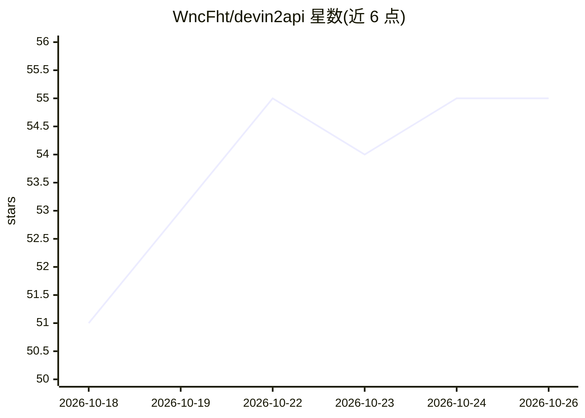

# WncFht/devin2api

⭐ 55 · Go · MIT · 推送 2026-10-24 · [GitHub](https://github.com/WncFht/devin2api) · [官网](https://wncfht.github.io/devin2api/) · 个人维护 · 中文 README

**把 Devin 账号模型包装成 OpenAI/Anthropic 兼容 API 的代理**

非官方协议适配器：使用自己的 Devin 凭据（平台 API key、会话 token 或 CLI 凭据文件）对接 Devin 内部 RPC，在本地暴露 /v1/responses、/v1/chat/completions、/v1/messages 三种 OpenAI/Anthropic 兼容端点，供 Codex、Claude Code 及任意标准 SDK 调用。支持流式响应、工具调用、多账号池与会话亲和、限流冷却、断连后的完成缓存及 /web 管理面板。分发为单一静态二进制，提供安装脚本、部署脚本与 GHCR Docker 镜像。README 声明与 Cognition 无关联，用户需自行遵守 Devin 服务条款。

## 筛选速览

| 维度 | 判定 | 备注 |
|---|---|---|
| AI 角色 | `ai-ecosystem` | LLM/agent 周边工具 |
| 许可风险 | `permissive` | MIT |
| 部署形态 | `desktop` | 安装包/桌面程序 |
| 模型依赖 | — | README 未给出锁定关系 |
| 硬件要求 | — | 无带数字的原话,不猜 |
| 安装摩擦 | `low` | 无编译、无系统依赖或容器化 |
| 成熟度 | — | 结构信号不足 |

## 能力要点

- 一个上游同时暴露 OpenAI Responses/Chat 与 Anthropic Messages 三种端点
- 多账号凭据池与会话亲和，凭据失效自动恢复，无需重启
- 限流冷却闩锁与可选 max_rpm 令牌桶整形出站请求
- 客户端断连后完成缓存保留上游流，重试可续接

## 适用场景

- 用 Claude Code、Codex 等标准客户端调用自己 Devin 账号的模型
- 多 Devin 账号做负载与配额池化管理
- 本地部署一个带管理面板的 LLM API 网关

## 场景标签

`模型网关` · 领域:Agent 开发

## 证据(README 行号)

> L9: devin-2api is an unofficial protocol adapter that exposes the models available to your Devin account (app.devin.ai) 
> L15: - **Three API surfaces on one upstream** — `POST /v1/responses` (OpenAI Responses, incl. a WebSocket transport with

## 星数曲线

2026-10-18 51 → 2026-10-26 55（+4）

---
*卡片 v1 · prompt 1.4 · 生成 2026-10-24 · 置信度 high · 依据 README sha `7e85db0601f2` · [字段定义](../../DATASET.md)*
