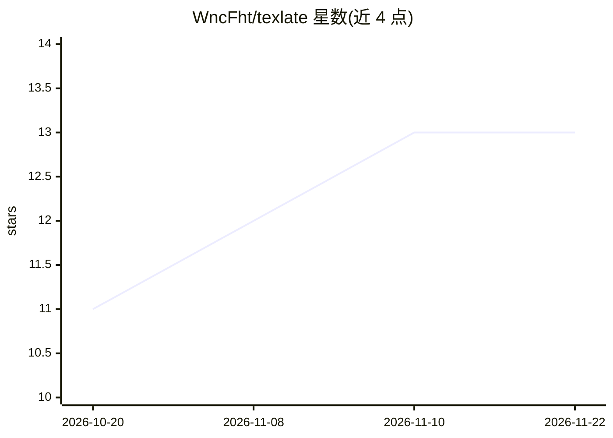

# WncFht/texlate

⭐ 13 · Python · NOASSERTION · 推送 2026-11-14 · [GitHub](https://github.com/WncFht/texlate) · 个人维护 · 中文 README

**科研人员：将 arXiv 论文译成段落级双语中文 PDF**

获取 arXiv 论文的 LaTeX 源码，只翻译段落文本，保护公式、引用与宏，再用中文排版环境重编译生成双语对照 PDF。采用 BYOK 模式，用户自配任意 OpenAI 兼容端点与密钥；真翻译由本地启动的 Web 服务执行，支持本地源码上传、PDF 侧车翻译、EPUB/DOCX 插译、译文共享与 Zotero 7 回挂。翻译按块保存进度可重试；无原始 TeX 的降级通道不提供源码级复制保证。提供 uv 安装、Docker 镜像与双语 Web 阅读器。

## 筛选速览

| 维度 | 判定 | 备注 |
|---|---|---|
| AI 角色 | `ai-native` | 本体是模型或模型工具 |
| 许可风险 | `permissive` | NOASSERTION |
| 部署形态 | `self-host` | docker 或自建部署 |
| 模型依赖 | — | README 未给出锁定关系 |
| 硬件要求 | — | 无带数字的原话,不猜 |
| 安装摩擦 | `low` | 无编译、无系统依赖或容器化 |
| 成熟度 | — | 结构信号不足 |

## 能力要点

- 段落级 LaTeX 翻译管线：保护公式、引用与宏，重编译双语 PDF
- BYOK：自配 OpenAI 兼容端点与密钥
- 双语阅读器含滚动同步、句级高亮与文献翻译队列
- Zotero 7 插件将中文 PDF 回挂到文献条目

## 适用场景

- 将 arXiv 论文生成为双语对照 PDF 阅读
- 上传本地 TeX 源码做翻译
- 在 Zotero 文献库中接入中文 PDF 产物

## 场景标签

`科研工具` · 领域:学习与行业

## 证据(README 行号)

> L5: TeXlate 是「幻觉翻译」的开源复现：获取 arXiv LaTeX 源码，只翻译段落文本，保护公式、引用与宏，再用中文排版环境重编译 PDF，供双语对照阅读。支持自带模型密钥（BYOK）、本地源码上传、PDF 侧车翻译、EPUB
> L20: 本地 `run` 使用占位译文验证链路，会获取源码并真实编译。真翻译由 Web 服务执行，先配置自己的模型端点与密钥：

## 星数曲线

2026-10-20 11 → 2026-11-22 13（+2）

---
*卡片 v1 · prompt 1.4 · 生成 2026-11-18 · 置信度 high · 依据 README sha `903fa141e4f6` · [字段定义](../../DATASET.md)*
