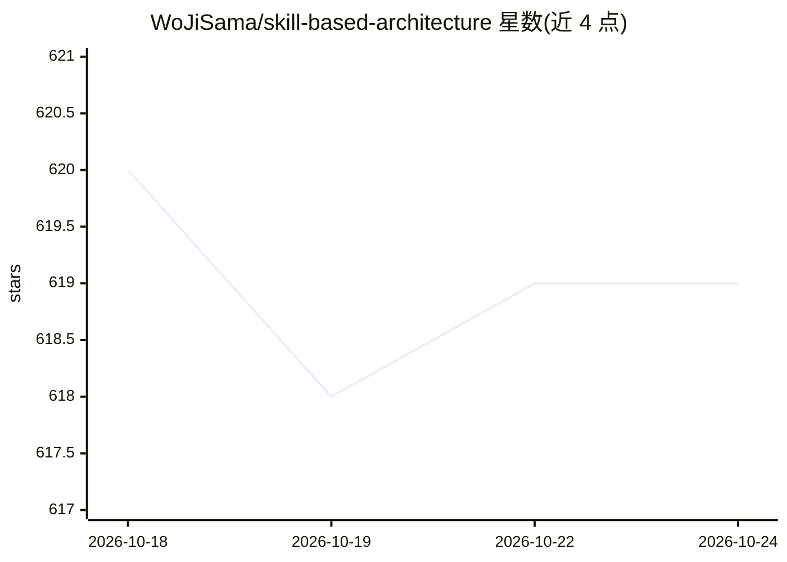

# WoJiSama/skill-based-architecture

⭐ 619 · Shell · MIT · 推送 2026-09-20 · [GitHub](https://github.com/WoJiSama/skill-based-architecture) · 个人维护 · 中文 README

**把项目规则蒸馏成可路由 Skill 的元技能，供各编码 Agent 遵循**

SBA 是一个供编码 Agent 使用的 Skill 而非运行时：对任意代码仓库盘点既有指令，抽取规则、业务含义与经验教训，生成 skills/<name>/ 目录作为单一事实来源，并建立任务路由、验证与跨工具入口。Agent 负责盘点、语义迁移与验证，用户仅保留产品与业务决策。安装方式为 Claude Code 插件两条命令或 git clone 到目标项目旁，兼容 Cursor、Codex、Windsurf、Gemini CLI 等 AGENTS.md/SKILL.md 读取方。README 提供本地示例仓库与只读预览 safeguards，限制为不提供 tier/profile 等安装模式开关，小项目可保持单文件 SKILL.md。

## 筛选速览

| 维度 | 判定 | 备注 |
|---|---|---|
| AI 角色 | `ai-ecosystem` | LLM/agent 周边工具 |
| 许可风险 | `permissive` | MIT |
| 部署形态 | `None` |  |
| 模型依赖 | — | README 未给出锁定关系 |
| 硬件要求 | — | 无带数字的原话,不猜 |
| 安装摩擦 | `low` | 无编译、无系统依赖或容器化 |
| 成熟度 | — | 结构信号不足 |

## 能力要点

- 盘点仓库并生成 skills/<name>/ 作为项目规则单一事实来源
- 按证据派生 direct/folder/broad 结构并建立任务路由与验证
- 写入前只读预览，报告 CREATE/PRESERVE/CONFLICT 决策
- 跨 harness 兼容（Claude Code/Cursor/Codex/Windsurf/Gemini CLI）

## 适用场景

- 把散落在 AGENTS.md/CLAUDE.md/Cursor rules 的重复规则统一迁移
- 让不同编码 Agent 共享同一套项目知识而不维护多套规则
- 为循环任务绑定工作流、验证与完成判定

## 场景标签

 · 领域:开发工具/AI 工程

## 证据(README 行号)

> L7:  SBA turns scattered agent instructions into one routable, verifiable, maintainable project Skill.
> L28: SBA gives the Agent a project-level operating contract. The Agent inventories the repository, selects one workflow,
> L159: |Harness family|Typical discovery or entry surface|

## 星数曲线

2026-10-18 620 → 2026-10-24 619（-1）

---
*卡片 v1 · prompt 1.4 · 生成 2026-10-21 · 置信度 high · 依据 README sha `74cb82e6bffb` · [字段定义](../../DATASET.md)*
