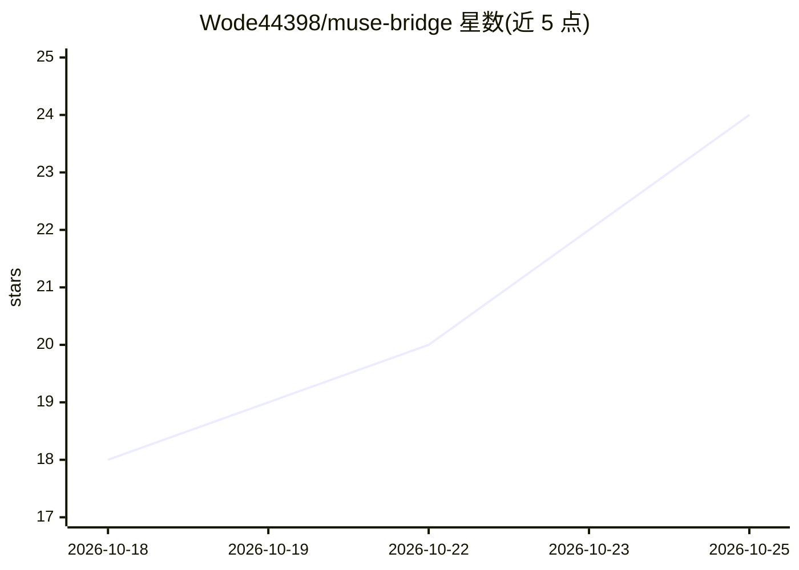

# Wode44398/muse-bridge

⭐ 26 · JavaScript · MIT · 推送 2026-10-25 · [GitHub](https://github.com/Wode44398/muse-bridge) · 个人维护 · 中文 README

**在 Muse VM 上一键部署 Claude Code 与多模型 agent 工作台**

面向 Muse agent VM 用户的部署与访问层：向 Muse 发送一条消息即可下载 release、完成安装并注册自愈 watchdog，之后在浏览器（手机或电脑）中使用 Claude Code 写代码、管理文件与运行命令；亦可安装 dimensio——一个多模型 agent 工作台，支持 Anthropic、OpenAI、Gemini、DeepSeek、Kimi、智谱 GLM、Qwen、小米 MiMo 及任意 OpenAI 兼容端点，每家各配一个 API key，可随时切换模型。限制：运行于 Muse VM 而非生产服务器，agent 无浏览器工具；也提供通用 Debian/Ubuntu systemd 安装脚本。

## 筛选速览

| 维度 | 判定 | 备注 |
|---|---|---|
| AI 角色 | `ai-ecosystem` | LLM/agent 周边工具 |
| 许可风险 | `permissive` | MIT |
| 部署形态 | `None` |  |
| 模型依赖 | locked-api |  |
| 硬件要求 | — | 无带数字的原话,不猜 |
| 安装摩擦 | `low` | 无编译、无系统依赖或容器化 |
| 成熟度 | — | 结构信号不足 |

## 能力要点

- 一条消息完成部署，无需接触终端
- dimensio 支持 8 家模型厂商及任意 OpenAI 兼容端点，模型随时切换
- watchdog 在 VM 重启后 60 秒内恢复服务，更新失败自动回滚
- 提供 Android WebView 应用与多用户邀请码机制

## 适用场景

- 在手机或电脑浏览器里使用完整的 Claude Code
- 在一个工作台里切换多家模型厂商对话并各用其自带搜索
- 通过邀请码让朋友共用部署、按人分配可用 agent

## 场景标签

`编码 Agent` `AI 助手` · 领域:编码与开发

## 证据(README 行号)

> L5: **One-message deployment of Claude Code on your Muse agent VM.** Once it's installed, open a URL in any browser, on 
> L17: - **dimensio, a multi-model workspace.** One API key per provider, switch models at any time, or add any OpenAI-com

## 星数曲线

2026-10-18 18 → 2026-10-25 24（+6）

---
*卡片 v1 · prompt 1.4 · 生成 2026-10-18 · 置信度 high · 依据 README sha `672c03a8095e` · [字段定义](../../DATASET.md)*
