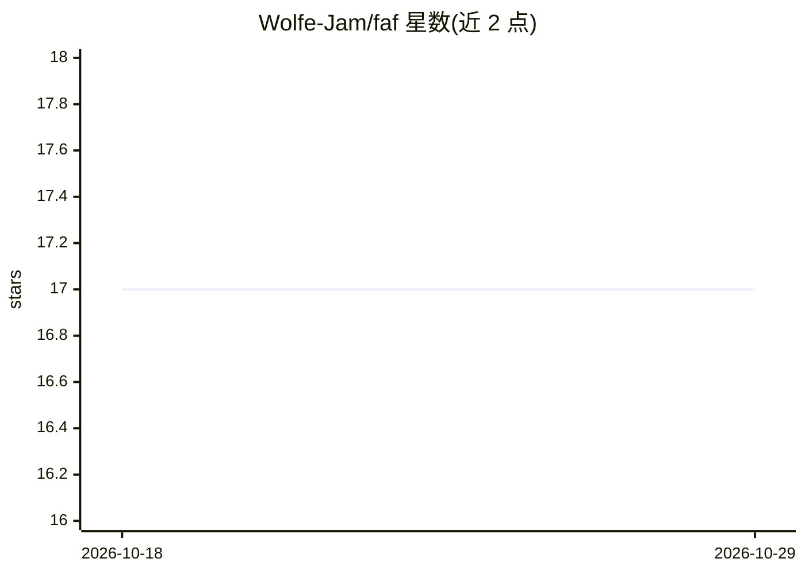

# Wolfe-Jam/faf

⭐ 17 · MIT · 推送 2026-09-24 · [GitHub](https://github.com/Wolfe-Jam/faf) · [官网](https://faf.one) · 个人维护

**给开发者的 IANA 注册 AI 上下文格式规范（.faf）及配套 CLI/MCP 工具链**

FAF 是一个面向 AI 上下文的开放格式规范：以结构化 YAML 文件 project.faf（application/vnd.faf+yaml，已 IANA 注册）描述项目的技术栈、依赖、架构与目标，供 Claude、Cursor、Gemini 等 AI 编码工具读取。配套工具包括 npm 发行的 faf-cli（可自动生成 project.faf、双向同步 AGENTS.md/CLAUDE.md/.cursorrules/GEMINI.md、33 槽位 0-100 评分）与 claude-faf-mcp（38 个 Claude 工具）。使用方式为 npm install -g faf-cli 后在项目内初始化，格式采用 YAML 1.2、MIT 许可。

## 筛选速览

| 维度 | 判定 | 备注 |
|---|---|---|
| AI 角色 | `ai-ecosystem` | LLM/agent 周边工具 |
| 许可风险 | `permissive` | MIT |
| 部署形态 | `library` | 以包/库形式分发 |
| 模型依赖 | — | README 未给出锁定关系 |
| 硬件要求 | — | 无带数字的原话,不猜 |
| 安装摩擦 | `low` | 无编译、无系统依赖或容器化 |
| 成熟度 | — | 结构信号不足 |

## 能力要点

- 三个 IANA 注册媒体类型：.faf / .fafm / .fafa
- faf-cli 自动生成 project.faf 并双向同步 4 种 AI 指令文件
- 33 槽位确定性 0-100 评分，算法公开可手工验证
- 覆盖 npm/PyPI/crates.io 的 MCP 生态与 Rust→WASM 编译工具链

## 适用场景

- 用一份 project.faf 向任意 AI 编码助手提供项目上下文，避免重复解释
- 从一份结构化文件生成 AGENTS.md / CLAUDE.md / .cursorrules / GEMINI.md
- 通过 faf git <url> 在数秒内了解任意 GitHub 仓库的结构化概览
- 衡量并补全项目 AI 上下文的完整度评分

## 场景标签

 · 领域:开发者工具/AI 上下文格式规范

## 证据(README 行号)

> L100: **.faf** (Foundational AI-context Format) is an IANA-registered open format for AI context — **Persistent project 
> L113: |**WHY** do you need it?|Context persists across sessions. Bi-syncs to AGENTS.md, CLAUDE.md, .cursorrules, GEMINI.
> L115: |**HOW** does it work?|`npx faf-cli init` — or `npx faf-cli git <url>` for any GitHub repo, no install, no clone|

## 星数曲线

2026-10-18 17 → 2026-10-29 17（+0）

---
*卡片 v1 · prompt 1.4 · 生成 2026-10-29 · 置信度 mid · 依据 README sha `a54154b61932` · [字段定义](../../DATASET.md)*
