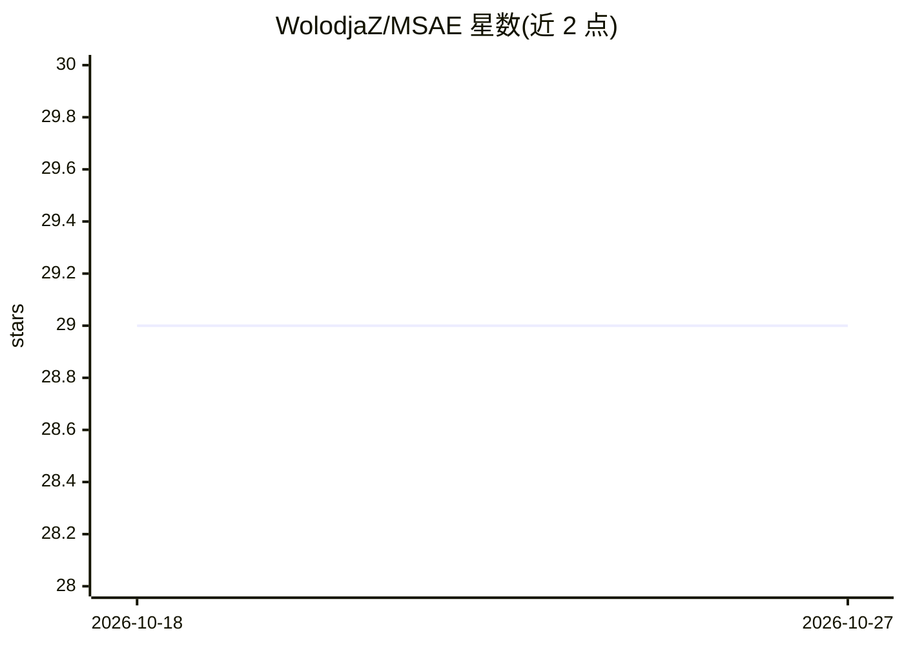

# WolodjaZ/MSAE

⭐ 29 · Jupyter Notebook · MIT · 推送 2026-01-17 · [GitHub](https://github.com/WolodjaZ/MSAE) · [官网](https://arxiv.org/abs/2502.20578) · 个人维护

**ICML 2025 论文代码：用层级稀疏自编码器解释 CLIP**

Matryoshka SAE（MSAE）的研究代码：一种在多粒度上同时学习层级表示的稀疏自编码器架构，用于检测和引导 CLIP/SigLIP 等视觉-语言模型中的可解释特征。以 PyTorch 实现，提供激活预计算、模型训练与 5 类评估脚本，支持从 CLIP 表示中抽取语义概念做相似度搜索与偏差分析。训练好的模型托管在 Hugging Face。本仓库为 ICML 2025 论文的重构版，训练速度接近论文版 10 倍，并修复了文本评估标准化的 bug，结果可能与论文略有差异。

## 筛选速览

| 维度 | 判定 | 备注 |
|---|---|---|
| AI 角色 | `ai-native` | 本体是模型或模型工具 |
| 许可风险 | `permissive` | MIT |
| 部署形态 | `library` | 以包/库形式分发 |
| 模型依赖 | — | README 未给出锁定关系 |
| 硬件要求 | — | 无带数字的原话,不猜 |
| 安装摩擦 | `low` | 无编译、无系统依赖或容器化 |
| 成熟度 | — | 结构信号不足 |

## 能力要点

- 多粒度层级稀疏自编码器（Matryoshka SAE）架构实现
- 提供激活预计算、训练与 5 个评估脚本及 demo.ipynb
- 预训练模型托管于 Hugging Face
- 从 CLIP 表示抽取 120+ 语义概念用于相似度搜索与偏差分析

## 适用场景

- 复现论文中 CLIP 解释性与稀疏性实验
- 训练并评估自己的层级稀疏自编码器
- 对 CLIP 表示做概念抽取与偏差分析

## 场景标签

 · 领域:机器学习可解释性研究

## 证据(README 行号)

> L15: Sparse autoencoders (SAEs) are useful for detecting and steering interpretable features in neural networks, with pa
> L11:  :rocket: International Conference on Machine Learning 2025 :rocket:

## 星数曲线

2026-10-18 29 → 2026-10-27 29（+0）

---
*卡片 v1 · prompt 1.4 · 生成 2026-10-26 · 置信度 mid · 依据 README sha `15287c356ff8` · [字段定义](../../DATASET.md)*
