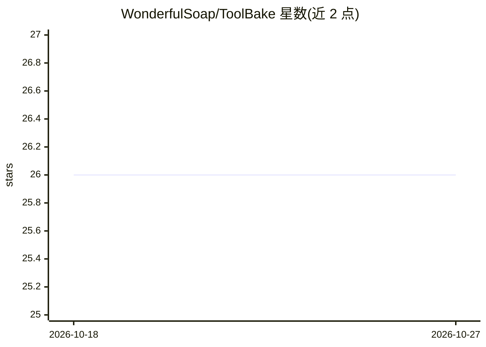

# WonderfulSoap/ToolBake

⭐ 26 · TypeScript · MIT · 推送 2026-06-03 · [GitHub](https://github.com/WonderfulSoap/ToolBake) · [官网](https://toolbake.com) · 个人维护

**浏览器内自定义工具箱平台，可用 AI 辅助生成工具**

ToolBake 是一个创建自定义工具的平台：在浏览器中定义 UI 组件与 handler 逻辑，本地运行，内置官方工具集（生活、开发、音频、视频、图像处理、游戏等）。内置 AI 助手可按对话描述生成 uiWidgets 与 handler 代码。可在浏览器中运行 ffmpeg、ffprobe、ImageMagick 并扩展 npm 包；默认数据存本地，登录 SSO 后可同步工具到服务器（不同步 OpenAI API Key）。自托管提供二进制、Docker 与 Docker Compose 三种方式，二进制运行后访问 localhost:8080。开发文档尚不完整（Roadmap 自述）。

## 筛选速览

| 维度 | 判定 | 备注 |
|---|---|---|
| AI 角色 | `ai-enhanced` | 去掉 AI 部分产品仍成立 |
| 许可风险 | `permissive` | MIT |
| 部署形态 | `desktop` | 安装包/桌面程序 |
| 模型依赖 | — | README 未给出锁定关系 |
| 硬件要求 | — | 无带数字的原话,不猜 |
| 安装摩擦 | `low` | 无编译、无系统依赖或容器化 |
| 成熟度 | — | 结构信号不足 |

## 能力要点

- 浏览器内定义 UI 与 handler 逻辑创建自定义工具
- AI 助手按对话描述生成 uiWidgets 与 handler 代码
- 浏览器内运行 ffmpeg/ffprobe/ImageMagick，可用 npm 包扩展
- 提供二进制、Docker、Docker Compose 三种自托管方式

## 适用场景

- 在浏览器本地处理音视频与图片，数据不上传
- 不写或少写代码，用 AI 助手生成自己需要的工具
- 自托管部署一个团队/个人的工具箱平台

## 场景标签

`AI 助手` `图像视频处理` `代码生成` · 领域:编码与开发

## 证据(README 行号)

> L18: ToolBake focuses on customization, local-first execution, and practical power in the browser:
> L21: - 🤖 **AI-assisted tool creation**: Describe your requirements in chat and let the built-in AI generate `uiWidgets` 

## 星数曲线

2026-10-18 26 → 2026-10-27 26（+0）

---
*卡片 v1 · prompt 1.4 · 生成 2026-10-26 · 置信度 high · 依据 README sha `d2d1589c5a09` · [字段定义](../../DATASET.md)*
