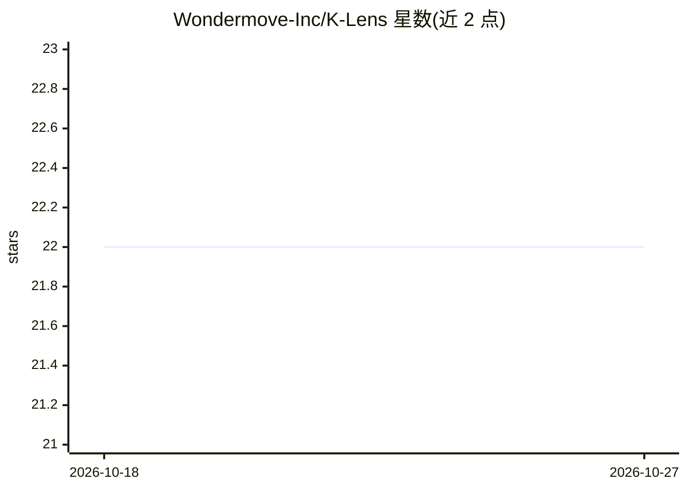

# Wondermove-Inc/K-Lens

⭐ 22 · TypeScript · MIT · 推送 2026-09-01 · [GitHub](https://github.com/Wondermove-Inc/K-Lens) · [官网](https://github.com/Wondermove-Inc/K-Lens) · 组织维护 · 中文 README

**面向 SRE 的 AI 辅助 Kubernetes 管理桌面 IDE**

基于 Open Lens 的 Electron 桌面应用，提供多集群管理、集成 kubectl 终端、Helm Chart 管理、Monaco YAML 编辑器与 Prometheus/Metrics Server 资源可视化。AI 部分（DAIVE）基于 LangChain，支持 Claude/GPT/Gemini 多模型，做故障自动诊断、根因分析（5 Whys/Ishikawa）、CVE/KSV 漏洞扫描与分级修复建议、资源右尺寸与成本分析。提供 macOS/Windows/Linux 安装包，也可从源码构建（Node.js 22+、pnpm）；macOS 版未签名需手动移除隔离属性。

## 筛选速览

| 维度 | 判定 | 备注 |
|---|---|---|
| AI 角色 | `ai-enhanced` | 去掉 AI 部分产品仍成立 |
| 许可风险 | `permissive` | MIT |
| 部署形态 | `desktop` | 安装包/桌面程序 |
| 模型依赖 | locked-api |  |
| 硬件要求 | — | 无带数字的原话,不猜 |
| 安装摩擦 | `low` | 无编译、无系统依赖或容器化 |
| 成熟度 | — | 结构信号不足 |

## 能力要点

- LangChain 多模型（Claude/GPT/Gemini）AI SRE 诊断引擎 DAIVE
- 检测 CrashLoopBackOff/OOMKilled 等故障并给出根因分析与修复建议
- CVE/KSV 漏洞扫描与 Tier 1–3 分级自动修复提案
- 多集群管理、集成终端、Helm 管理与 YAML 编辑一体化

## 适用场景

- 在单一桌面 UI 中管理多个 Kubernetes 集群
- Pod 故障时让 AI 自动扫描日志与事件并定位根因
- 对集群做漏洞扫描、资源右尺寸与成本优化分析

## 场景标签

`网络安全` · 领域:学习与行业

## 证据(README 行号)

> L41: Built on Open Lens, enhanced with AI-powered SRE diagnostics, security scanning, and real-time observability.
> L89: DAIVE is K-Lens's built-in AI engine that acts as a senior SRE on your team. Powered by LangChain with multi-model 

## 星数曲线

2026-10-18 22 → 2026-10-27 22（+0）

---
*卡片 v1 · prompt 1.4 · 生成 2026-10-27 · 置信度 mid · 依据 README sha `ab7ab17e668a` · [字段定义](../../DATASET.md)*
