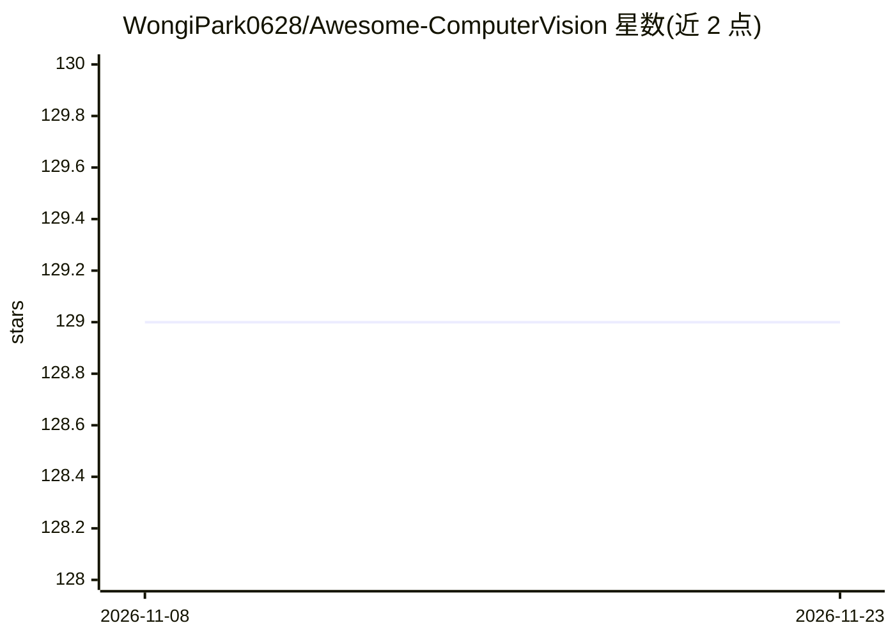

# WongiPark0628/Awesome-ComputerVision

⭐ 129 · Python · MIT · 推送 2026-11-07 · [GitHub](https://github.com/WongiPark0628/Awesome-ComputerVision) · 个人维护

**计算机视觉论文与代码资源清单（分类/检测/分割/元学习等）**

一个以表格形式编目的计算机视觉论文资源合集：按图像分类、目标检测、语义分割、细粒度视觉分类、元学习、图像自监督学习六个类别组织，每条条目记录年份、论文名称、论文 PDF 与代码链接（GitHub/Kaggle/Colab）。收录范围从 1998 年 LeNet 到 2026 年的视觉语言模型论文，接受社区 Pull Request 持续更新。不提供可运行的软件，仅作为文献与代码索引。

## 筛选速览

| 维度 | 判定 | 备注 |
|---|---|---|
| AI 角色 | `ai-knowledge` | 知识聚合/清单类 |
| 许可风险 | `permissive` | MIT |
| 部署形态 | `None` |  |
| 模型依赖 | — | README 未给出锁定关系 |
| 硬件要求 | — | 无带数字的原话,不猜 |
| 安装摩擦 | `low` | 无编译、无系统依赖或容器化 |
| 成熟度 | — | 结构信号不足 |

## 能力要点

- 覆盖 1998-2026 年六个计算机视觉类别的论文条目
- 每条目附论文 PDF 与 GitHub/Kaggle/Colab 代码链接
- 开放 Pull Request 贡献，持续更新

## 适用场景

- 按类别查找计算机视觉经典与近期论文及对应代码
- 为研究方向（如细粒度分类、自监督学习）做文献调研
- 寻找可复现实验的 Colab/Kaggle 笔记本入口

## 场景标签

`精选清单` `科研工具` · 领域:学习与行业

## 证据(README 行号)

> L2: This repository is a collection of useful materials for Computer Vision.
> L8: ## Image Classification

## 星数曲线

2026-11-08 129 → 2026-11-23 129（+0）

---
*卡片 v1 · prompt 1.4 · 生成 2026-11-17 · 置信度 high · 依据 README sha `ce7181b39f14` · [字段定义](../../DATASET.md)*
