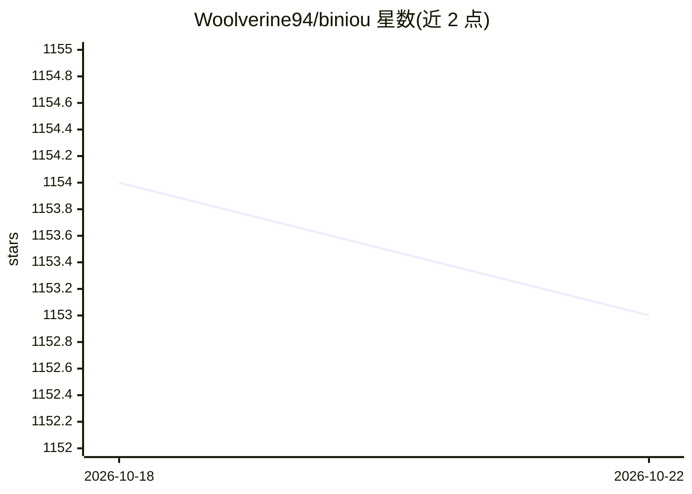

# Woolverine94/biniou

⭐ 1,153 · Python · GPL-3.0 · 推送 2026-10-22 · [GitHub](https://github.com/Woolverine94/biniou) · 个人维护

**自托管的多模态生成式 AI WebUI，覆盖文本/图像/音频/视频/3D 生成**

基于 Hugging Face 与 Gradio 的本地 WebUI，聚合 30+ 生成式 AI 模块：llama.cpp 聊天机器人（GGUF）、Whisper 语音转文字、Stable Diffusion/Flux 系列图像生成与修改、MusicGen/Bark 音频生成、AnimateDiff 视频生成、Shap-E 3D 生成等，模块间可传递输出作为输入。面向在自有电脑上运行生成式 AI 的用户，最低 8GB 内存、无需独显 GPU，部署后可离线使用；提供各 Linux 发行版一键安装脚本、Windows exe 安装器与 Dockerfile。macOS Intel 为实验性支持。

## 筛选速览

| 维度 | 判定 | 备注 |
|---|---|---|
| AI 角色 | `ai-native` | 本体是模型或模型工具 |
| 许可风险 | `viral` | GPL-3.0 |
| 部署形态 | `desktop` | 安装包/桌面程序 |
| 模型依赖 | local-ok | 支持本地模型 |
| 硬件要求 | `cpu-ok` | |
| 安装摩擦 | `low` | 无编译、无系统依赖或容器化 |
| 成熟度 | `idea` | |

## 能力要点

- 文本/图像/音频/视频/3D 五类生成模块，模块输出可作为另一模块输入
- 最低 8GB 内存、无需专用 GPU 即可运行，部署后可离线使用
- 支持 CUDA 与实验性 ROCm，llama.cpp 可切换 CUDA/OpenBLAS/OpenCL/ROCm/Vulkan 优化
- WebUI 内置控制面板：更新/重启/认证/网络访问控制与在线共享实例

## 适用场景

- 在自己电脑上本地运行聊天机器人和图像/音频/视频生成，不依赖云端服务
- 将生成结果在模块间串联处理（如图像生成后放大或换脸）
- 在无独立 GPU 的低配机器上体验生成式 AI

## 场景标签

`聊天机器人` `图像生成` `视频生成` `语音识别` · 领域:对话与助手

## 证据(README 行号)

> L7:  biniou is a self-hosted webui for several kinds of GenAI (generative artificial intelligence). You can generate mul
> L65: * **Text generation using :**
> L93: * **Audio generation using :**
> L101: * **Video generation and modification using :**

## 星数曲线

2026-10-18 1,154 → 2026-10-22 1,153（-1）

---
*卡片 v1 · prompt 1.4 · 生成 2026-10-21 · 置信度 mid · 依据 README sha `54e837ab45bc` · [字段定义](../../DATASET.md)*
