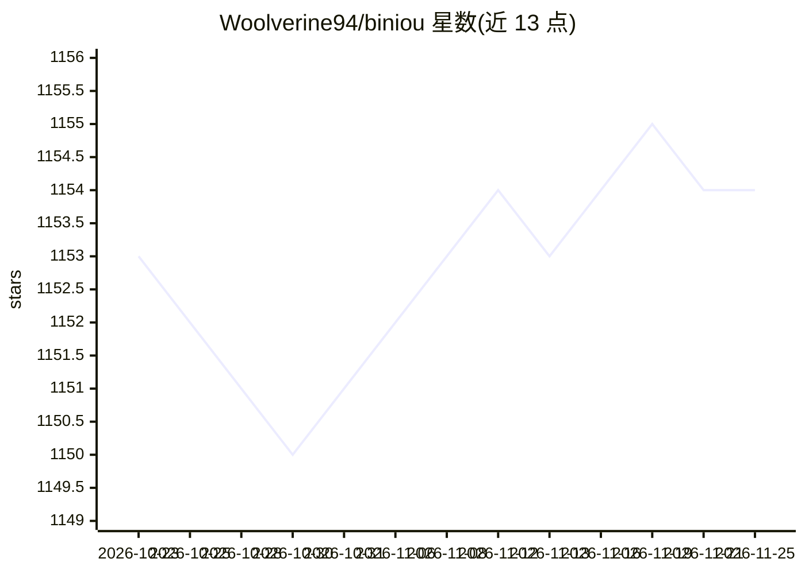

# Woolverine94/biniou

⭐ 1,154 · Python · GPL-3.0 · 推送 2026-11-23 · [GitHub](https://github.com/Woolverine94/biniou) · 个人维护

**自托管多媒体生成 WebUI：本地运行 30+ 生成式 AI 模块**

面向自托管用户的生成式 AI WebUI，基于 Hugging Face 与 Gradio 构建，覆盖文本、图像、音频、视频、3D 物体五大类生成模块，另含聊天机器人、图像描述、语音转文字与翻译模块。通过 llama-cpp 运行 .gguf 模型，支持 CUDA、ROCm（实验性）与 Vulkan 等加速选项，也可在无独显、8GB RAM 的机器上运行，部署并下载模型后可离线使用。提供各发行版一键安装脚本、Windows 安装包与 Dockerfile，WebUI 内置控制面板管理更新、认证与网络访问。

## 筛选速览

| 维度 | 判定 | 备注 |
|---|---|---|
| AI 角色 | `ai-native` | 本体是模型或模型工具 |
| 许可风险 | `viral` | GPL-3.0 |
| 部署形态 | `desktop` | 安装包/桌面程序 |
| 模型依赖 | local-ok | 支持本地模型 |
| 硬件要求 | `cpu-ok` | |
| 安装摩擦 | `low` | 无编译、无系统依赖或容器化 |
| 成熟度 | — | 结构信号不足 |

## 能力要点

- 覆盖文本/图像/音频/视频/3D 五类 30+ 生成模块
- 基于 llama-cpp 运行 GGUF 量化模型，支持 Llava 多模态与 200 语言翻译
- 模块间可传递输出作为输入，生成设置以元数据保存
- 支持 CUDA/ROCm（实验性）/OpenBLAS/Vulkan，无需独显可运行

## 适用场景

- 在本地电脑离线生成图像、音乐、语音和视频
- 自托管多合一生成式 AI 工作站并管理模型
- 在无独显的机器上运行聊天机器人与语音转文字

## 场景标签

`聊天机器人` `图像生成` `语音识别` · 领域:对话与助手

## 证据(README 行号)

> L7:  biniou is a self-hosted webui for several kinds of GenAI (generative artificial intelligence). You can generate mul
> L69: * **Text generation using :**
> L124:  - Powered by 🤗 Huggingface and gradio

## 星数曲线

2026-10-23 1,153 → 2026-11-25 1,154（+1）

---
*卡片 v1 · prompt 1.4 · 生成 2026-11-24 · 置信度 mid · 依据 README sha `c08d83fd58c9` · [字段定义](../../DATASET.md)*
