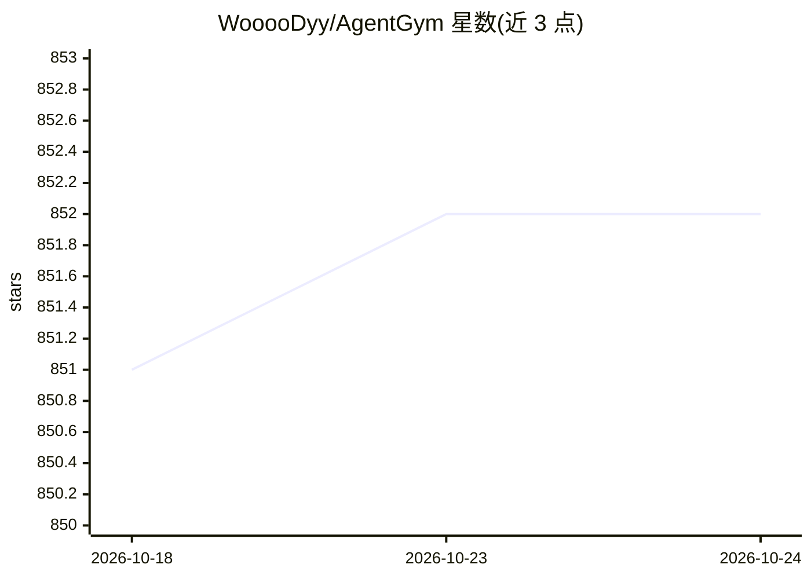

# WooooDyy/AgentGym

⭐ 851 · Python · MIT · 推送 2026-05-30 · [GitHub](https://github.com/WooooDyy/AgentGym) · [官网](https://arxiv.org/abs/2406.04151) · 组织维护

**LLM 智能体训练评测框架：多环境交互与进化**

复旦大学团队（Zhiheng Xi 等，ACL 2025 论文）发布的 LLM 智能体训练与评测框架：提供 14 个统一 ReAct 格式的交互环境（网页导航、文字游戏、具身任务、工具使用、编程等），环境以独立 HTTP 服务部署，通过 /createEnv、/step 等接口解耦；核心组件 AgentController 负责评测、数据收集与训练。附带 AgentTraj-L 轨迹集、AgentEval 基准和 AgentEvol 自进化方法，并发布 AgentEvol-7B 模型，另有 AgentGym-RL 强化学习版本。以 pip 包与源码方式安装，各环境需单独部署。

## 筛选速览

| 维度 | 判定 | 备注 |
|---|---|---|
| AI 角色 | `ai-ecosystem` | LLM/agent 周边工具 |
| 许可风险 | `permissive` | MIT |
| 部署形态 | `library` | 以包/库形式分发 |
| 模型依赖 | — | README 未给出锁定关系 |
| 硬件要求 | — | 无带数字的原话,不猜 |
| 安装摩擦 | `low` | 无编译、无系统依赖或容器化 |
| 成熟度 | — | 结构信号不足 |

## 能力要点

- 14 个统一 ReAct 格式的交互环境，支持实时反馈与并发
- 环境以 HTTP 服务解耦部署，开发者可封装接口自建环境
- 附带 AgentTraj-L 轨迹集、AgentEval 基准与 AgentEvol 训练方法
- 提供轨迹回放与可视化前端

## 适用场景

- 在多环境中评测 LLM 智能体的能力
- 收集轨迹数据并用 AgentEvol/行为克隆训练智能体
- 封装自定义环境接入框架做强化学习

## 场景标签

`模型评测` `强化学习` `微调` · 领域:评测与运维

## 证据(README 行号)

> L21: **AgentGym** is a new framework featuring a variety of environments and tasks for broad, real-time, uniformat, and 
> L25: AgentGym is a framework designed to help the community easily evaluate and develop generally-capable LLM-based agen
> L50: We have implemented 14 types of environments, and **developers can easily develop new environments and add them to 

## 星数曲线

2026-10-18 851 → 2026-10-24 852（+1）

---
*卡片 v1 · prompt 1.4 · 生成 2026-10-22 · 置信度 high · 依据 README sha `004807adc335` · [字段定义](../../DATASET.md)*
