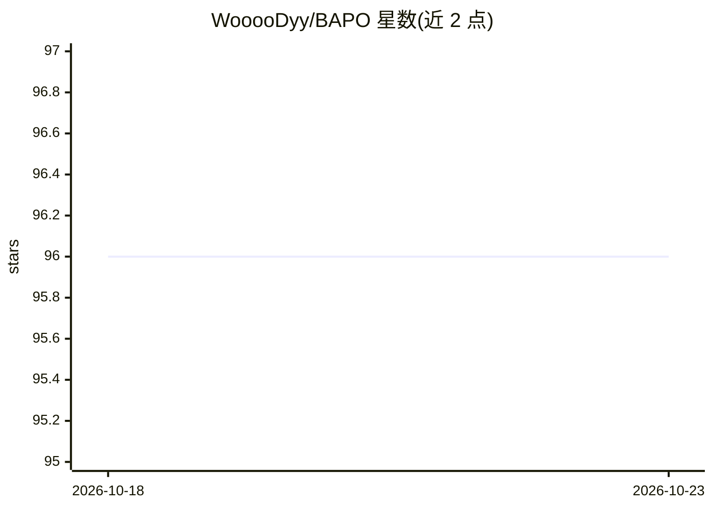

# WooooDyy/BAPO

⭐ 96 · Python · 推送 2026-01-29 · [GitHub](https://github.com/WooooDyy/BAPO) · 组织维护 · 中文 README

**LLM 离线强化学习训练算法 BAPO 的论文官方实现**

论文 "BAPO: Stabilizing Off-Policy Reinforcement Learning for LLMs" 的官方代码仓库，基于 verl 框架实现开源版本。BAPO 通过动态调整 PPO 裁剪上下界，使正优势样本对策略梯度损失的贡献达到目标比例，应对离线 RL 中的优化不平衡与熵坍缩问题。提供 git clone 安装与单节点训练脚本，超参数在 YAML 配置中设定；模型主要基于 Qwen2.5 系列与 DeepSeek-R1-Distill-Qwen 训练，推理使用 vLLM。

## 筛选速览

| 维度 | 判定 | 备注 |
|---|---|---|
| AI 角色 | `ai-ecosystem` | LLM/agent 周边工具 |
| 许可风险 | `none` | — |
| 部署形态 | `None` |  |
| 模型依赖 | — | README 未给出锁定关系 |
| 硬件要求 | — | 无带数字的原话,不猜 |
| 安装摩擦 | `low` | 无编译、无系统依赖或容器化 |
| 成熟度 | — | 结构信号不足 |

## 能力要点

- 自适应裁剪机制动态调整 PPO 裁剪上下界
- 保留策略熵以维持稳定探索
- 基于 verl 框架的开源实现，提供训练脚本与 YAML 配置
- 32B 与 7B 模型在 AIME 2024/2025 上报告了评测结果

## 适用场景

- 对 LLM 执行离线/部分 rollout 强化学习训练
- 研究替代固定裁剪的 PPO 类目标以缓解熵坍缩
- 复现论文中的 BAPO 训练与超参数设置

## 场景标签

`强化学习` · 领域:训练与推理

## 证据(README 行号)

> L14: This repository implements **Balanced Policy Optimization with Adaptive Clipping (BAPO)**, a simple yet effective r
> L29: BAPO dynamically adjusts the PPO clipping bounds ($c_{low}$ and $c_{high}$) to meet a target contribution ratio ($\

## 星数曲线

2026-10-18 96 → 2026-10-23 96（+0）

---
*卡片 v1 · prompt 1.4 · 生成 2026-10-23 · 置信度 high · 依据 README sha `7426cd1c1219` · [字段定义](../../DATASET.md)*
