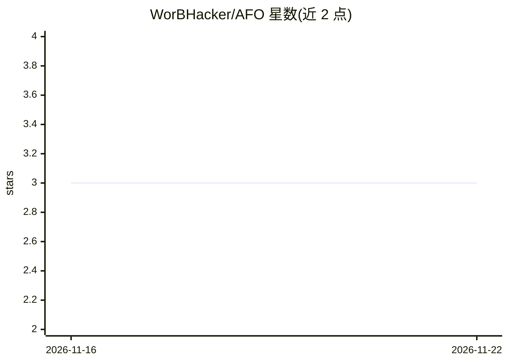

# WorBHacker/AFO

⭐ 3 · Python · GPL-3.0 · 推送 2026-11-21 · [GitHub](https://github.com/WorBHacker/AFO) · 个人维护

**Windows 本地 AI 生态：管理项目/终端/模型的枢纽加轻量桌面窗口**

由两部分组成：后台 hub 进程（127.0.0.1:8765）提供 API、WebSocket、数据库、模型网关（llama-swap 及 Claude/OpenAI/Gemini/DeepSeek/OpenRouter）、项目、终端、MCP 服务器与 OpenAI 兼容服务；PySide6/Qt Quick 桌面窗口用 CPU 渲染。内置自主 Agent，按四种自主级别运行，支持计划审批、定时/事件触发任务、多 Agent 协调与 UI 自动化操作（带确认机制）。提供 Windows 安装包（无需管理员权限），首次运行自动下载 llama.cpp 构建并引导安装本地 GGUF 模型。

## 筛选速览

| 维度 | 判定 | 备注 |
|---|---|---|
| AI 角色 | `ai-ecosystem` | LLM/agent 周边工具 |
| 许可风险 | `viral` | GPL-3.0 |
| 部署形态 | `desktop` | 安装包/桌面程序 |
| 模型依赖 | local-ok | 支持本地模型 |
| 硬件要求 | — | 无带数字的原话,不猜 |
| 安装摩擦 | `medium` | 含编译或系统依赖之一 |
| 成熟度 | — | 结构信号不足 |

## 能力要点

- hub 集成模型网关、MCP 服务器与 OpenAI 兼容服务，供 VS Code、Claude Code 与 Agent 接入
- 本地模型管理：搜索 Hugging Face GGUF、按显存筛选、多线程下载校验 sha256、收录 LM Studio/Ollama 已有模型文件
- 自主 Agent 四级模式（每步/先计划/自动/完全），支持定时与事件触发、多 Agent 并行协调
- API 密钥存入 Windows 凭据管理器，敏感操作走按类确认机制

## 适用场景

- 在 Windows 上一站式运行本地与云端 LLM 并统一管理模型文件
- 让 Agent 在确认机制下执行定时或事件触发的自动化任务
- 通过 MCP 服务器为 Agent 扩展外部工具
- 与 VS Code、Claude Code 等 CLI 工具共享项目与终端上下文

## 场景标签

`模型网关` `多智能体` `推理引擎` `AI 助手` · 领域:Agent 开发

## 证据(README 行号)

> L7: Локальная AI-экосистема: **хаб** знает проекты, процессы, терминалы и модели; **лёгкое приложение** на Qt Quick (QML
> L26: |`hub/`|хаб — фоновый процесс на `127.0.0.1:8765` (занят другой программой — на следующем свободном, адрес в `data/

## 星数曲线

2026-11-16 3 → 2026-11-22 3（+0）

---
*卡片 v1 · prompt 1.4 · 生成 2026-11-22 · 置信度 mid · 依据 README sha `ea3baca587e6` · [字段定义](../../DATASET.md)*
