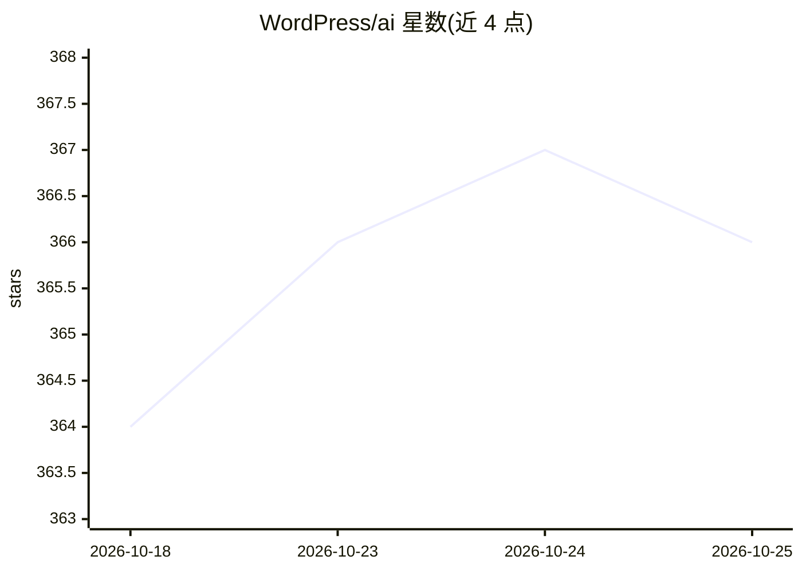

# WordPress/ai

⭐ 368 · PHP · GPL-2.0 · 推送 2026-10-23 · [GitHub](https://github.com/WordPress/ai) · [官网](https://wordpress.org/plugins/ai/) · 组织维护

**WordPress 官方 AI 插件：为编辑与管理员提供一系列可选 AI 功能**

WordPress 官方 AI 团队维护的实验性插件，作为 AI Building Blocks 的参考实现：把 PHP AI Client SDK 与 Abilities API 组合为统一体验，面向 WordPress 用户、内容创作者、站点管理员和学习 AI API 的开发者。功能包括替代文本生成、内容摘要/翻译/缩写、标题/摘要/slug 生成、图像生成与编辑、评论自动审核、编辑建议笔记等，均按 opt-in 实验框架逐项开启。插件本身不含 provider 凭据，需安装至少一个 AI Connector 插件（OpenAI/Google/Anthropic 等）并配置密钥。仅支持区块编辑器（Gutenberg），不支持经典编辑器。

## 筛选速览

| 维度 | 判定 | 备注 |
|---|---|---|
| AI 角色 | `ai-enhanced` | 去掉 AI 部分产品仍成立 |
| 许可风险 | `viral` | GPL-2.0 |
| 部署形态 | `None` |  |
| 模型依赖 | — | README 未给出锁定关系 |
| 硬件要求 | — | 无带数字的原话,不猜 |
| 安装摩擦 | `low` | 无编译、无系统依赖或容器化 |
| 成熟度 | `idea` | |

## 能力要点

- 20 余项可选 AI 功能（摘要、翻译、替代文本、图像生成、评论审核等）按 opt-in 实验框架开启
- 多 provider 接入：通过 AI Connector 插件支持 OpenAI、Google、Anthropic 等
- API 密钥静态加密存储（内置 libsodium），Connector 使用需管理员审批
- 提供 Abilities Explorer 与 AI 请求日志用于调试与可观测性

## 适用场景

- 在 WordPress 编辑器内对文章做摘要、翻译、改写与标题生成
- 自动为图片生成替代文本、生成 SEO 友好的 slug 与元描述
- 基于毒性检测与情感分析自动审核评论
- 插件开发者学习 AI Building Blocks 并注册自己的 AI abilities

## 场景标签

`图像生成` `AI 写作` · 领域:内容生成

## 证据(README 行号)

> L15: The AI plugin provides a set of opt-in AI features for authors, editors, and admins directly within WordPress. It s
> L44: 2. **User-focused** – Deliver practical AI features users can use today, integrated seamlessly into Gutenberg (bloc

## 星数曲线

2026-10-18 364 → 2026-10-25 366（+2）

---
*卡片 v1 · prompt 1.4 · 生成 2026-10-21 · 置信度 high · 依据 README sha `fb367c75d6c9` · [字段定义](../../DATASET.md)*
