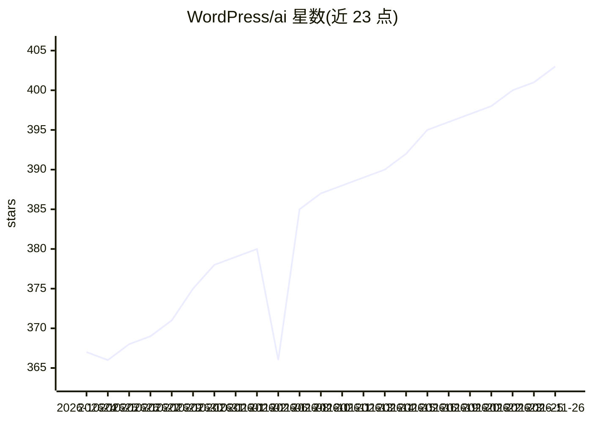

# WordPress/ai

⭐ 403 · PHP · GPL-2.0 · 推送 2026-11-25 · [GitHub](https://github.com/WordPress/ai) · [官网](https://wordpress.org/plugins/ai/) · 组织维护

**为 WordPress 用户提供可选 AI 功能与开发者参考实现**

WordPress 官方 AI 插件，以模块化框架形式提供一组默认关闭、按需开启的 AI 功能与实验，包括图像生成与编辑、Alt 文本/摘要/标题/翻译生成、评论审核、Markdown 订阅、MCP 接入等。面向 WordPress 用户、内容创作者、站点管理员与开发者；开发者可将其作为参考实现，复用 PHP AI Client SDK 与 Abilities API 构建或扩展 AI 工作流。仅支持区块编辑器，AI 功能需另行安装 AI Connector 插件并配置凭据。

## 筛选速览

| 维度 | 判定 | 备注 |
|---|---|---|
| AI 角色 | `ai-ecosystem` | LLM/agent 周边工具 |
| 许可风险 | `viral` | GPL-2.0 |
| 部署形态 | `None` |  |
| 模型依赖 | — | README 未给出锁定关系 |
| 硬件要求 | — | 无带数字的原话,不猜 |
| 安装摩擦 | `low` | 无编译、无系统依赖或容器化 |
| 成熟度 | — | 结构信号不足 |

## 能力要点

- 默认关闭的 opt-in 功能与实验体系，实验可随时变动或移除
- 稳定功能：图像生成与编辑；20+ 实验覆盖摘要、翻译、审核、TTS 等
- 多提供商支持，通过 AI Connector 插件接入 OpenAI、Google、Anthropic 等
- 基于 AI Building Blocks（PHP AI Client SDK、Abilities API）的可扩展框架

## 适用场景

- 在 WordPress 编辑器中生成与编辑文章配图
- 为图片生成替代文本、为长文生成摘要与标题建议
- 通过 MCP 或 Markdown 订阅向 AI 代理暴露站点能力
- 作为插件开发者构建自有 AI 实验的参考实现

## 场景标签

`图像生成` `语音合成` `AI 写作` · 领域:内容生成

## 证据(README 行号)

> L15: The AI plugin provides a set of opt-in AI features for authors, editors, and admins directly within WordPress. It s
> L24: * **Purpose:** Demonstrate and deliver AI features by combining the AI Building Blocks (PHP AI Client SDK, Abilitie
> L93: * **Multi-Provider Support** - Works with AI Connector plugins for providers such as OpenAI, Google, and Anthropic.

## 星数曲线

2026-10-24 367 → 2026-11-26 403（+36）

---
*卡片 v1 · prompt 1.4 · 生成 2026-11-25 · 置信度 high · 依据 README sha `c6dc8393cb99` · [字段定义](../../DATASET.md)*
