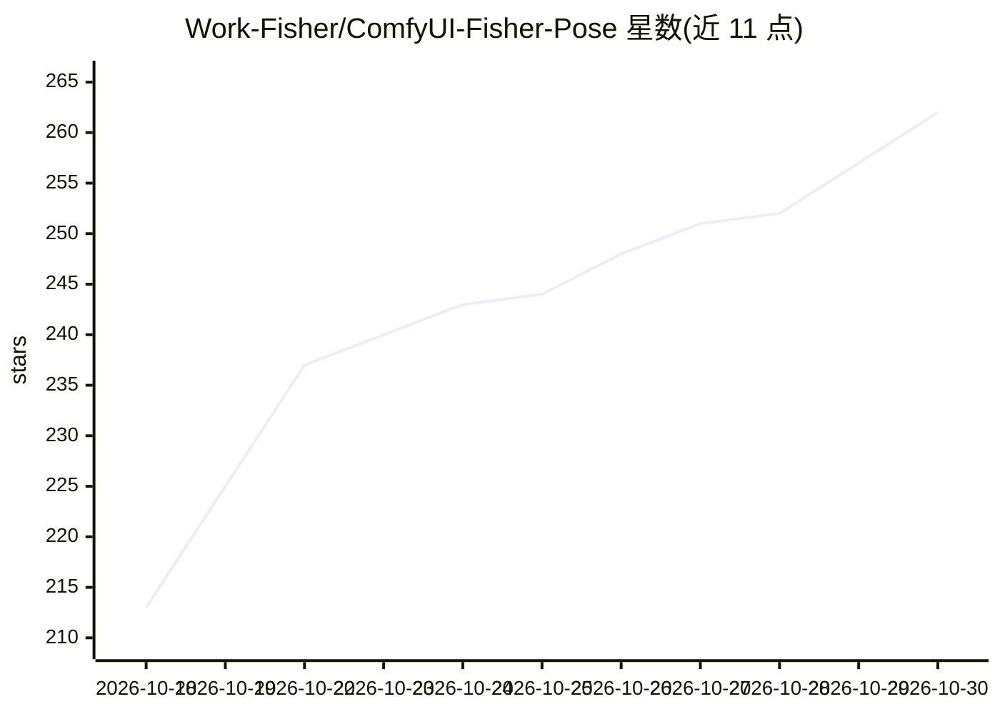

# Work-Fisher/ComfyUI-Fisher-Pose

⭐ 262 · JavaScript · NOASSERTION · 推送 2026-10-10 · [GitHub](https://github.com/Work-Fisher/ComfyUI-Fisher-Pose) · 个人维护 · 中文 README

**ComfyUI 姿势与机位编辑插件，配合 Qwen Image 生成**

ComfyUI 自定义节点，面向使用 Qwen Image 2.1 生图的创作者：提供 VNCCS 真人人偶与 209 张内置 OpenPose 骨架的姿势编辑器，支持单人/双人分别摆姿，并可切换正/侧/俯/仰等拍摄机位（换机位需追加 6 个机位模型与 AnyAngle）。可选 DWPose 插件从照片识别姿势，另有骨架微调、参考图对位、身材预设与姿势保存。工作流以 JSON 文件导入，基础用法需 4 个模型。

## 筛选速览

| 维度 | 判定 | 备注 |
|---|---|---|
| AI 角色 | `ai-ecosystem` | LLM/agent 周边工具 |
| 许可风险 | `none` | NOASSERTION |
| 部署形态 | `None` |  |
| 模型依赖 | — | README 未给出锁定关系 |
| 硬件要求 | — | 无带数字的原话,不猜 |
| 安装摩擦 | `low` | 无编译、无系统依赖或容器化 |
| 成熟度 | — | 结构信号不足 |

## 能力要点

- VNCCS 人偶拖关节摆姿，内置 209 张骨架与 29 个常用姿势
- 单人/双人独立调整姿势，合照免手动裁切
- 编辑观察与拍摄机位分离，支持多视角换镜头
- 可选 DWPose 照片识别姿势、姿势保存与个人图库

## 适用场景

- 在 ComfyUI 里摆好人物姿势后用 Qwen Image 生成对应画面
- 用一张合照给两个人分别设计动作再出图
- 同一姿势切换不同镜头角度生成多视角结果

## 场景标签

`图像生成` · 领域:内容生成

## 证据(README 行号)

> L5: 在 ComfyUI 中编辑单人或双人姿势，用 Qwen Image 2.1 生成对应画面。
> L21: ### 单人 · 骨架、人偶与成图
> L45: ### 多视角 · 同一姿势，改变镜头

## 星数曲线

2026-10-18 213 → 2026-10-30 262（+49）

---
*卡片 v1 · prompt 1.4 · 生成 2026-10-22 · 置信度 high · 依据 README sha `445c81db89a8` · [字段定义](../../DATASET.md)*
