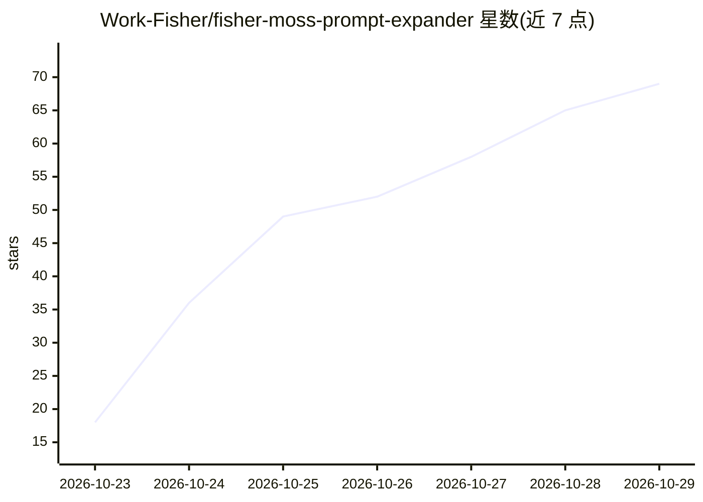

# Work-Fisher/fisher-moss-prompt-expander

⭐ 69 · Python · Apache-2.0 · 推送 2026-10-22 · [GitHub](https://github.com/Work-Fisher/fisher-moss-prompt-expander) · 个人维护 · 中文 README

**把一句画面想法展开为详细生图提示词的中文 SKILL 与模板**

面向支持 Skills 的 Agent（如 Codex）与 ComfyUI 用户的提示词生成技能包：输入一句话或参考图，按锁定人数动作、选择构图骨架、绑定人物道具、展开空间光色的流程，输出默认约 1500—2500 汉字的详细中文提示词，或 ComfyUI 文本扩写节点可用的英文 Caption。包含 6 篇教学长例、12 组图像与提示词配对案例及验收记录。项目只生成提示词文本，不调用生图服务；不含 ComfyUI 自定义节点；改编自 OpenMOSS/MOSS-Image，非其官方插件。

## 筛选速览

| 维度 | 判定 | 备注 |
|---|---|---|
| AI 角色 | `ai-knowledge` | 知识聚合/清单类 |
| 许可风险 | `permissive` | Apache-2.0 |
| 部署形态 | `None` |  |
| 模型依赖 | — | README 未给出锁定关系 |
| 硬件要求 | — | 无带数字的原话,不猜 |
| 安装摩擦 | `low` | 无编译、无系统依赖或容器化 |
| 成熟度 | — | 结构信号不足 |

## 能力要点

- 一句话/参考图展开为详细中文提示词或英文 Caption
- 提供 Codex 技能目录安装方式与 ComfyUI 精简执行模板
- 6 篇完整长例与 12 组图像-提示词配对案例
- 支持多图独立输出、局部修改、多角色跨视图绑定等特殊输入

## 适用场景

- 我在写生图提示词时希望一句话自动展开成详细描述
- 在 ComfyUI 工作流中用文本扩写节点生成英文 Caption
- 参考图像与提示词配对案例学习提示词写法

## 场景标签

`提示工程` `教程课程` · 领域:Agent 开发

## 证据(README 行号)

> L23: |在支持 Skills 的 Agent 中，把一句话或参考图展开|fisher-moss-prompt-expander|默认详细中文提示词；自由创作约 1500—2500 汉字|
> L25: |阅读完整方法与案例|SKILL 完整单文件 MD|规则、六篇长案例、局部模块和验收记录|
> L99: 由 **Work-Fisher** 整理。MOSS-Image 完整参考模板改编自 OpenMOSS/MOSS-Image 的提示词增强技能；上游快照与原文说明保留在模板中。

## 星数曲线

2026-10-23 18 → 2026-10-29 69（+51）

---
*卡片 v1 · prompt 1.4 · 生成 2026-10-24 · 置信度 high · 依据 README sha `0598d7e8e435` · [字段定义](../../DATASET.md)*
