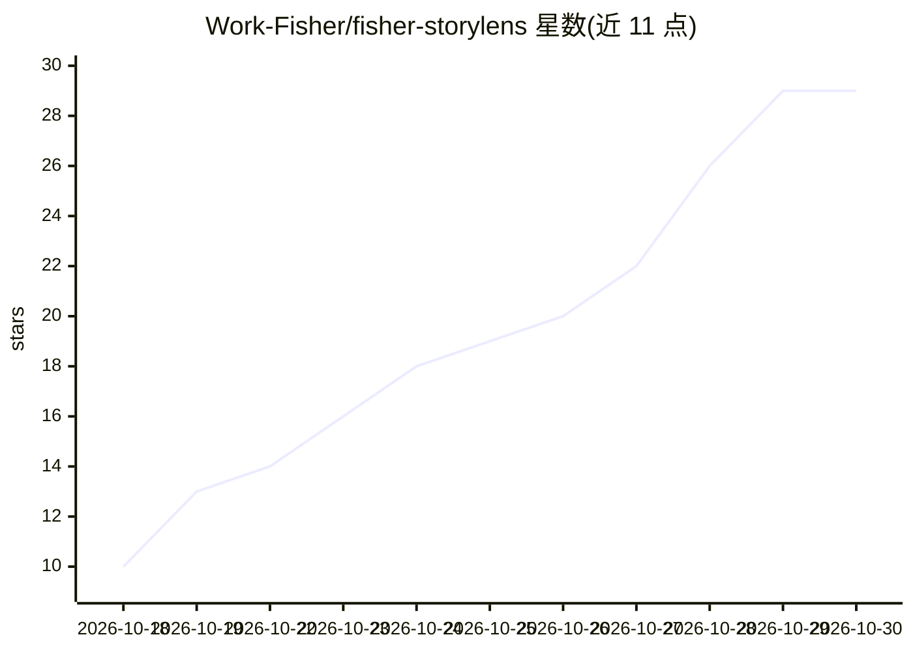

# Work-Fisher/fisher-storylens

⭐ 29 · 推送 2026-10-15 · [GitHub](https://github.com/Work-Fisher/fisher-storylens) · 个人维护 · 中文 README

**短剧制作提示词 Skill：串联 Z-Image/Qwen-Image/MiniMax H3 三阶段流程**

以 SKILL.md 形式交付的中文短剧创作提示词助手：围绕 Z-Image（角色/场景生图）、Qwen-Image 2.1（图像编辑/多视图）与 MiniMax H3（图生视频）搭建三阶段可逐步确认的流程，先定角色、再定场景，最后依据用户上传的真实图片编写 15 秒分镜视频提示词（固定3–4镜头、A/B机位）。Skill 只负责写提示词，模型运行依赖外部 ComfyUI 工作流与可读取 SKILL.md 的对话助手，不附模型权重。已做提示词行为测试，未验证实际视频生成效果。

## 筛选速览

| 维度 | 判定 | 备注 |
|---|---|---|
| AI 角色 | `ai-native` | 本体是模型或模型工具 |
| 许可风险 | `none` | — |
| 部署形态 | `None` |  |
| 模型依赖 | — | README 未给出锁定关系 |
| 硬件要求 | — | 无带数字的原话,不猜 |
| 安装摩擦 | `low` | 无编译、无系统依赖或容器化 |
| 成熟度 | — | 结构信号不足 |

## 能力要点

- 三阶段流程：角色提示词 → 场景提示词 → 依据真实图片的视频提示词
- 15秒分段、3–4镜头、A/B机位选择规则
- 保持原剧本事件与逐字台词的连续性约束
- 提供 RunningHub 云端与夸克网盘本地两种配套工作流入口

## 适用场景

- 把中文剧本转为角色、场景生图提示词与分镜视频提示词
- 制作韩剧式悬疑短剧并保持剧情与台词连续性
- 在本地 ComfyUI 环境跑 Z-Image→Qwen→MiniMax H3 制作链路

## 场景标签

`提示工程` `图像生成` `视频生成` `工作流自动化` · 领域:Agent 开发

## 证据(README 行号)

> L9: 围绕 **Z-Image → Qwen-Image 2.1 → MiniMax H3** 搭建本地短剧制作链路，面向韩剧式悬疑、复仇与人物对峙的中文创作 Skill。把角色生图、场景生图和 MiniMax 视频提示词串成一条可逐步确
> L146: 这是提示词创作 Skill，不是 ComfyUI 插件或一键视频生成器，也不附带模型权重、API密钥或素材图。默认适用于韩剧式文戏，人物国籍和对白语言仍以原剧本为准。

## 星数曲线

2026-10-18 10 → 2026-10-30 29（+19）

---
*卡片 v1 · prompt 1.4 · 生成 2026-10-27 · 置信度 high · 依据 README sha `3d353445d761` · [字段定义](../../DATASET.md)*
