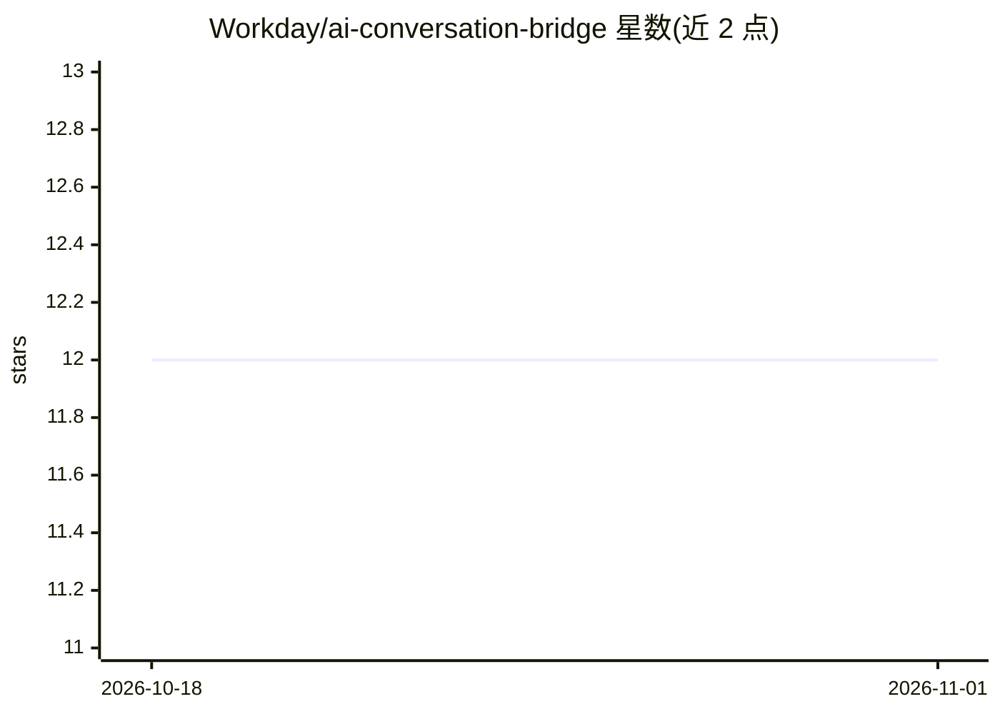

# Workday/ai-conversation-bridge

⭐ 12 · Python · Apache-2.0 · 推送 2026-10-30 · [GitHub](https://github.com/Workday/ai-conversation-bridge) · 组织维护 · 中文 README

**将企业聊天应用接入 Workday 的 AI 对话桥接参考架构**

Workday 官方发布的参考架构：通过桥接服务把 LINE WORKS、钉钉、飞书等企业聊天平台连接到 Workday，内进程运行 LangGraph 编排器，经 MCP server 调用 Workday 数据，面向 APJ 地区（中日韩）合规与本地化场景。默认部署到 Cloud Run，LLM 走 OpenRouter 或其他 OpenAI 兼容接口。仓库附带返回 mock 数据的演示 MCP server，生产需自建完整 MCP 集成；Flowise 编排路径已标记废弃（EOL 2026-08-31）。

## 筛选速览

| 维度 | 判定 | 备注 |
|---|---|---|
| AI 角色 | `ai-ecosystem` | LLM/agent 周边工具 |
| 许可风险 | `permissive` | Apache-2.0 |
| 部署形态 | `self-host` | docker 或自建部署 |
| 模型依赖 | — | README 未给出锁定关系 |
| 硬件要求 | — | 无带数字的原话,不猜 |
| 安装摩擦 | `low` | 无编译、无系统依赖或容器化 |
| 成熟度 | — | 结构信号不足 |

## 能力要点

- LINE WORKS、钉钉、飞书三类聊天适配器，WeChat/KakaoTalk 未随仓库提供
- 默认 LangGraph 编排 + MCP 工具调用，支持 Direct LLM 无工具模式
- Cloud Run 部署脚本与本地 Docker Compose 冒烟测试两种路径
- 演示 MCP server 仅返回 mock Workday 数据，生产需完整集成

## 适用场景

- 让员工在微信/钉钉/飞书等聊天应用内完成 Workday 操作
- 在数据合规要求下用自有 LLM 构建企业 AI 对话入口
- 参考其桥接架构自建聊天平台到企业系统的集成

## 场景标签

`聊天机器人` · 领域:对话与助手

## 证据(README 行号)

> L11: A reference architecture that connects enterprise messaging apps (LINE WORKS, WeChat, Feishu, etc.) to Workday usin
> L35: Chat platforms  ←→  bridge service (LangGraph)  ←→  MCP server  ←→  Workday

## 星数曲线

2026-10-18 12 → 2026-11-01 12（+0）

---
*卡片 v1 · prompt 1.4 · 生成 2026-11-01 · 置信度 mid · 依据 README sha `242370eb8069` · [字段定义](../../DATASET.md)*
