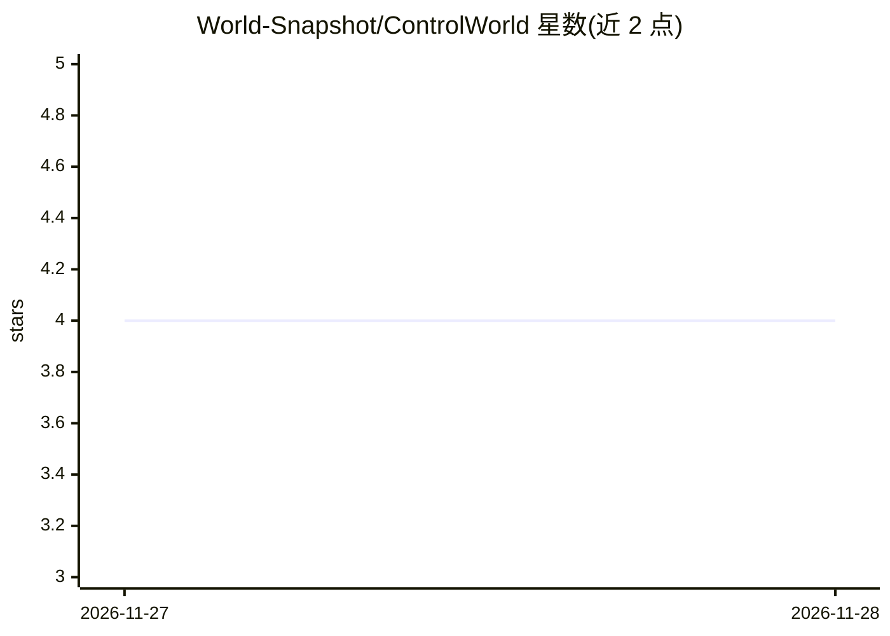

# World-Snapshot/ControlWorld

⭐ 4 · Python · MIT · 推送 2026-11-22 · [GitHub](https://github.com/World-Snapshot/ControlWorld) · 组织维护

**给研究者提供的 WSM 世界快照模型插件式推理控制 WebUI**

ControlWorld 是 World Snapshot 生态的交互控制面板，以插件机制接入模型：每个模型自带界面后端、依赖与任务定义，宿主保持模型无关，统一提供插件发现、执行、可视化与管理。用户在任务图中选输入/输出路线，提供图像或文本条件，运行推荐 checkpoint，查看解码结果与实时推理日志。支持从 URL 安装 GitHub/Hugging Face 仓库插件，非破坏式启用/禁用插件，含共享 Viser 3D 服务，可部署到 Hugging Face GPU Space。

## 筛选速览

| 维度 | 判定 | 备注 |
|---|---|---|
| AI 角色 | `ai-ecosystem` | LLM/agent 周边工具 |
| 许可风险 | `permissive` | MIT |
| 部署形态 | `None` |  |
| 模型依赖 | — | README 未给出锁定关系 |
| 硬件要求 | — | 无带数字的原话,不猜 |
| 安装摩擦 | `low` | 无编译、无系统依赖或容器化 |
| 成熟度 | — | 结构信号不足 |

## 能力要点

- 插件机制接入模型，宿主模型无关，插件含各自后端与任务定义
- 任务图可视化选路，支持图像/文本/音频/参考等多条件输入
- 非 RGB 结果用 WSG Reader 可视化与数值图例，实时推理日志可见
- Plugin Manager 支持从 GitHub/Hugging Face URL 安装插件

## 适用场景

- 在浏览器里选择已训练的任务路线并运行 WSM checkpoint 推理
- 通过 Viser 服务与插件交互式查看 3D 场景结果
- 把完整界面以 Docker 导出部署到 Hugging Face GPU Space

## 场景标签

`图像生成` · 领域:内容生成

## 证据(README 行号)

> L12: ControlWorld is the interactive control panel of the World Snapshot ecosystem. It turns a model's directed visual-t
> L14: The host remains model-independent. Each model carries its own interface, backend, requirements, and task definitio

## 星数曲线

2026-11-27 4 → 2026-11-28 4（+0）

---
*卡片 v1 · prompt 1.4 · 生成 2026-11-27 · 置信度 mid · 依据 README sha `ce378b8d20f6` · [字段定义](../../DATASET.md)*
