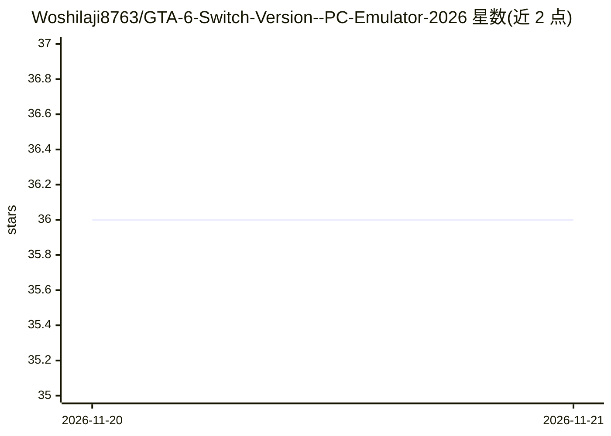

# Woshilaji8763/GTA-6-Switch-Version--PC-Emulator-2026

⭐ 36 · Rust · Apache-2.0 · 推送 2026-11-19 · [GitHub](https://github.com/Woshilaji8763/GTA-6-Switch-Version--PC-Emulator-2026) · 个人维护

**面向 Windows 玩家的 GTA VI PC 版安装与配置指南站点**

该项目提供一个 Windows 安装伴侣程序（companion installer），并附带面向 GTA VI 未来 PC 版的准备工作文档：Windows 更新、GPU 驱动验证、存储检查、Rockstar Games Launcher 准备、图形与 FPS 优化建议、安装故障排查及 FAQ。README 明确说明安装包不包含 GTA VI 游戏文件，官方 PC 版发布日期与系统要求截至 2026 年 11 月尚未公布，要求用户通过授权渠道另行购买游戏。文档末尾含 SEO 关键词区块。

## 筛选速览

| 维度 | 判定 | 备注 |
|---|---|---|
| AI 角色 | `ai-knowledge` | 知识聚合/清单类 |
| 许可风险 | `permissive` | Apache-2.0 |
| 部署形态 | `desktop` | 安装包/桌面程序 |
| 模型依赖 | — | README 未给出锁定关系 |
| 硬件要求 | — | 无带数字的原话,不猜 |
| 安装摩擦 | `low` | 无编译、无系统依赖或容器化 |
| 成熟度 | `idea` | |

## 能力要点

- 提供 Windows 兼容性检查清单（系统版本/DirectX/驱动/存储）
- 图形设置与 FPS 排查的通用配置说明
- 安装伴侣程序明确声明不含 GTA VI 游戏文件
- 系统要求表格各字段均标注为未确认

## 适用场景

- 在 GTA VI PC 版发布前提前准备 Windows 环境与驱动
- 排查 PC 游戏常见的低帧、卡顿与显示问题
- 了解 Rockstar Games Launcher 的获取与配置入口

## 场景标签

 · 领域:游戏/桌面工具

## 证据(README 行号)

> L5: A dedicated PC installation and configuration resource for Grand Theft Auto VI, covering Windows preparation, graphi
> L19: The installation resource focuses on:
> L49: The companion installer does not contain or install GTA VI game files.

## 星数曲线

2026-11-20 36 → 2026-11-21 36（+0）

---
*卡片 v1 · prompt 1.4 · 生成 2026-11-20 · 置信度 mid · 依据 README sha `6954d37a13d3` · [字段定义](../../DATASET.md)*
