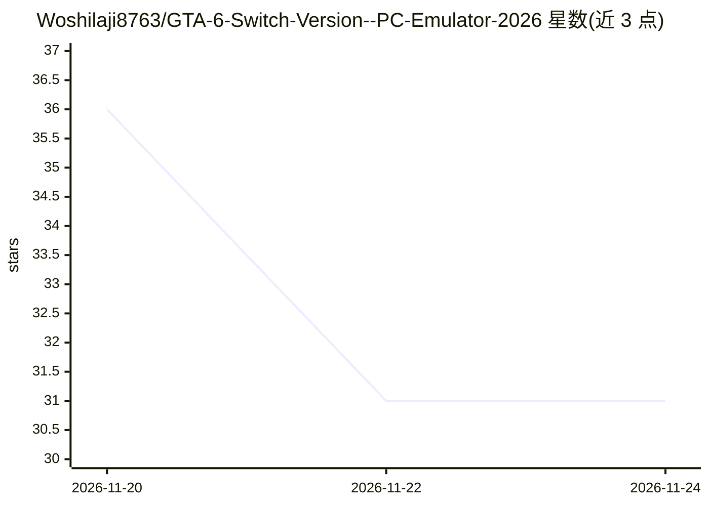

# Woshilaji8763/GTA-6-Switch-Version--PC-Emulator-2026

⭐ — · [GitHub]() · 个人维护

**面向 Windows 玩家的 GTA VI PC 安装准备指南与配套工具**

针对尚未发布 PC 版的 Grand Theft Auto VI 提供安装前准备的文档型项目：覆盖 Windows 更新、NVIDIA/AMD/Intel 显卡驱动更新链接、SSD 存储检查、Rockstar Games Launcher 准备、Windows Game Mode 配置，以及图形设置与 FPS 排障说明。附带一个 Windows 配套安装器（.exe），README 明确声明其不含也不安装 GTA VI 游戏文件，游戏需从授权渠道获取。官方 PC 硬件要求与发布日期均未确认，页面以占位表格呈现。

## 筛选速览

| 维度 | 判定 | 备注 |
|---|---|---|
| AI 角色 | `ai-enhanced` | 去掉 AI 部分产品仍成立 |
| 许可风险 | `permissive` | — |
| 部署形态 | `desktop` | 安装包/桌面程序 |
| 模型依赖 | — | README 未给出锁定关系 |
| 硬件要求 | — | 无带数字的原话,不猜 |
| 安装摩擦 | `low` | 无编译、无系统依赖或容器化 |
| 成熟度 | `idea` | |

## 能力要点

- Windows 环境准备清单：系统更新、驱动验证、存储与兼容性检查
- 提供 NVIDIA/AMD/Intel 官方驱动下载链接
- 图形设置与 FPS/卡顿/显示问题排障条目
- 声明配套安装器不含游戏文件，需经授权渠道购买游戏

## 适用场景

- 提前准备运行 GTA VI PC 版的 Windows 环境
- 排查 PC 游戏常见的 FPS 低、卡顿、显示初始化错误
- 配置 Rockstar Games Launcher 与显卡驱动

## 场景标签

 · 领域:游戏/桌面工具

## 证据(README 行号)

> L17: This repository is dedicated to Windows users preparing for the future PC edition of GTA VI.
> L49: The companion installer does not contain or install GTA VI game files.

## 星数曲线

2026-11-20 36 → 2026-11-24 31（-5）

---
*卡片 v1 · prompt 1.4 · 生成 2026-11-22 · 置信度 low · 依据 README sha `2fe487426686` · [字段定义](../../DATASET.md)*
