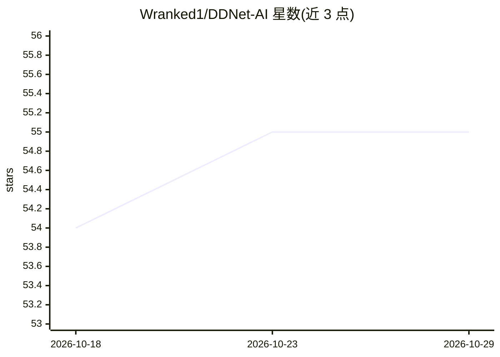

# Wranked1/DDNet-AI

⭐ 55 · TypeScript · GPL-3.0 · 推送 2026-10-11 · [GitHub](https://github.com/Wranked1/DDNet-AI) · [官网](https://wranked1.github.io/DDNet-AI/) · 个人维护

**在 DDNet 中自主游玩 block 模式的 Windows 机器人**

以独立客户端形式加入 DDNet block 服务器的游戏机器人：内置从 DDNet 20 移植的游戏物理副本，每秒 25 次在前向半秒内推演数十种动作方案（跑位、跳跃、钩子、锤击），选取使对手更靠近冰冻区的方案；计入自身延迟对世界状态进行前推。提供 Electron 封装的 Windows 单文件 exe（内含 Node.js），Linux/macOS 需 Node.js 24+ 运行 run.sh。支持目标选择、队友/敌人/忽略名单、命令行控制、自动选服与自动更新；计算仅用 CPU，无需显卡。

## 筛选速览

| 维度 | 判定 | 备注 |
|---|---|---|
| AI 角色 | `ai-native` | 本体是模型或模型工具 |
| 许可风险 | `viral` | GPL-3.0 |
| 部署形态 | `desktop` | 安装包/桌面程序 |
| 模型依赖 | — | README 未给出锁定关系 |
| 硬件要求 | — | 无带数字的原话,不猜 |
| 安装摩擦 | `low` | 无编译、无系统依赖或容器化 |
| 成熟度 | — | 结构信号不足 |

## 能力要点

- 内置 DDNet 20 物理副本，每步前向推演数十个动作方案择优
- Windows 单文件 exe，内含窗口与 Node.js，开箱即用
- 计入自身 ping 的世界状态前推
- !friend/!war/!ignore 等命令与 F3/F4 代投票控制

## 适用场景

- 让机器人替我在 DDNet block 服务器上对战挂机
- 通过命令行指定战斗目标或模式（fight/passive/hold）
- 游戏时用迷你悬浮窗旁观机器人战况

## 场景标签

 · 领域:游戏/自动化工具

## 证据(README 行号)

> L66: Бот держит у себя копию физики DDNet 20 и на каждом шаге прогоняет в ней десятки вариантов на полсекунды вперёд: ку
> L3: **Бот, который сам играет в блок в DDNet**

## 星数曲线

2026-10-18 54 → 2026-10-29 55（+1）

---
*卡片 v1 · prompt 1.4 · 生成 2026-10-24 · 置信度 mid · 依据 README sha `feed17c4e779` · [字段定义](../../DATASET.md)*
