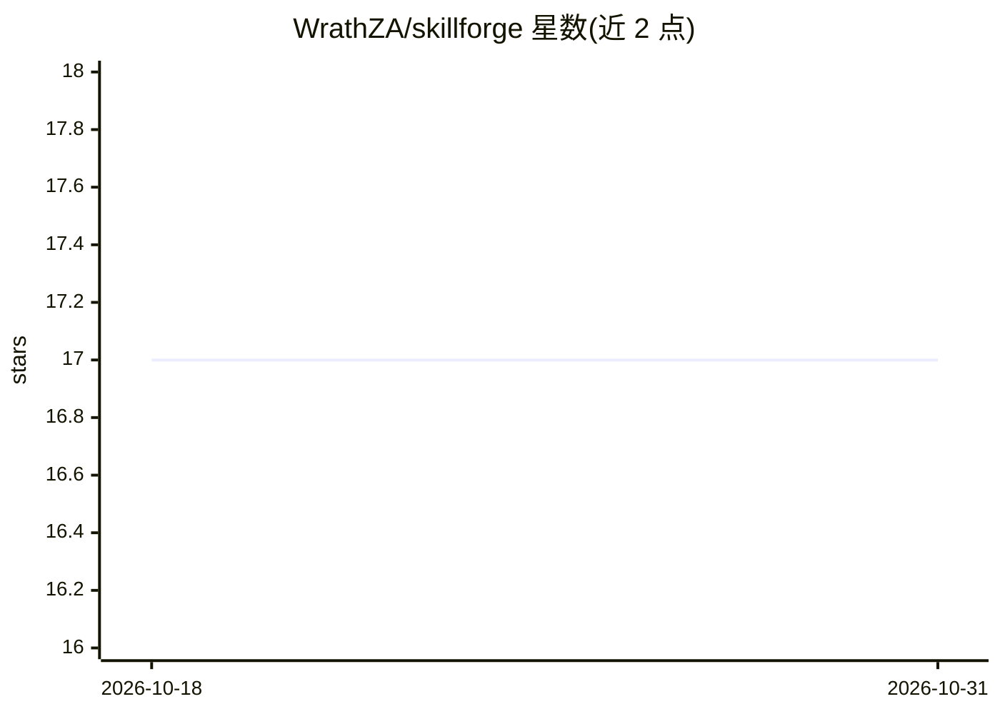

# WrathZA/skillforge

⭐ 17 · Shell · NOASSERTION · 推送 2026-07-09 · [GitHub](https://github.com/WrathZA/skillforge) · 个人维护

**面向 Claude Code 的技能创作工作流：构建、评审、人审落地技能**

由四个按序运行的技能组成的插件：recap 独立读取技能正文并判定漂移，create/update 负责新建与结构化更新技能，judge 按多维评分表（知识增量、反模式、可用性、规范符合度）给任意 prompt 打字母等级并输出改进清单，hitl 逐步走查编号列表并在每次批准后提交。以单一捆绑插件形式通过 Claude Code 插件市场安装；judge 与 hitl 可单独使用。本地开发需克隆仓库并运行 symlink 脚本。

## 筛选速览

| 维度 | 判定 | 备注 |
|---|---|---|
| AI 角色 | `ai-ecosystem` | LLM/agent 周边工具 |
| 许可风险 | `none` | NOASSERTION |
| 部署形态 | `None` |  |
| 模型依赖 | — | README 未给出锁定关系 |
| 硬件要求 | — | 无带数字的原话,不猜 |
| 安装摩擦 | `low` | 无编译、无系统依赖或容器化 |
| 成熟度 | — | 结构信号不足 |

## 能力要点

- 四技能闭环：recap → create/update → judge → HITL 应用
- judge 按多维评分表输出字母等级、分项分数与改进清单
- hitl 逐项审批、每项批准后提交
- 单一插件安装即获得完整 forge 循环

## 适用场景

- 为 Claude Code 编写或更新符合质量标准的技能
- 对任意 LLM 消费的 prompt 做评分与改进
- 逐步人审并落盘技能修改

## 场景标签

`提示工程` · 领域:Agent 开发

## 证据(README 行号)

> L3: Quality-gated skill authoring for Claude Code. Build, judge, and ship skills that earn their tokens.
> L5: Skill Forge is four skills that run in sequence (recap, create or update, judge, apply changes with human-in-the-loo

## 星数曲线

2026-10-18 17 → 2026-10-31 17（+0）

---
*卡片 v1 · prompt 1.4 · 生成 2026-10-29 · 置信度 high · 依据 README sha `e139e7f4cc21` · [字段定义](../../DATASET.md)*
