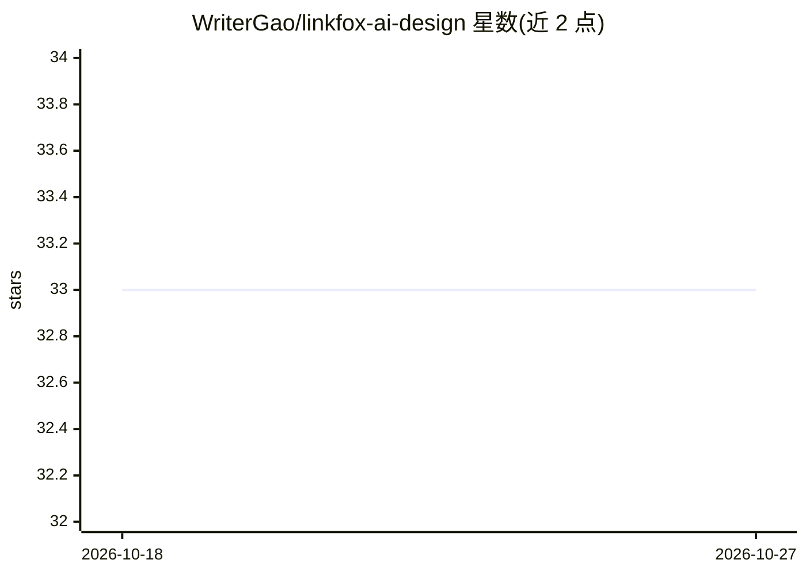

# WriterGao/linkfox-ai-design

⭐ 33 · Vue · 推送 2025-11-11 · [GitHub](https://github.com/WriterGao/linkfox-ai-design) · [官网](http://localhost:3001) · 个人维护 · 中文 README

**面向电商设计的 AI 图像生成全栈平台（Spring Boot + Vue3）**

基于 Spring Boot 3.2 与 Vue 3.4 的前后端分离 Web 平台，提供智能修图、场景替换、商品图生成、AI 穿衣、真人模特、批量生图六类 AI 图像功能，并配套用户注册登录、积分与 VIP 等级、作品上传与作品广场等系统。数据层用 MySQL 8 + MyBatis Plus 与 Redis，安全用 Spring Security + JWT。支持 Docker Compose 一键启动或 Maven/npm 手动构建运行，README 未说明各 AI 功能所调用的具体模型或外部服务。

## 筛选速览

| 维度 | 判定 | 备注 |
|---|---|---|
| AI 角色 | `ai-native` | 本体是模型或模型工具 |
| 许可风险 | `none` | — |
| 部署形态 | `self-host` | docker 或自建部署 |
| 模型依赖 | — | README 未给出锁定关系 |
| 硬件要求 | — | 无带数字的原话,不猜 |
| 安装摩擦 | `low` | 无编译、无系统依赖或容器化 |
| 成熟度 | — | 结构信号不足 |

## 能力要点

- 智能修图、场景制变、商品图、AI 穿衣、真人模特、批量生图六大功能
- 完整用户体系：注册登录、权限管理、积分与 VIP 等级
- 作品管理：上传、分类、点赞收藏与作品广场展示
- Docker Compose 一键部署，前后端分离架构

## 适用场景

- 电商商家批量制作商品图与场景图
- 通过虚拟试衣功能预览服装上身效果
- 搭建带用户与积分系统的 AI 设计服务网站

## 场景标签

`图像生成` · 领域:内容生成

## 证据(README 行号)

> L15: LinkFox AI设计平台是一个功能强大的AI驱动的图像生成和电商设计平台，提供智能修图、场景制变、商品图生成、AI穿衣、真人模特等多种AI设计功能。
> L21: LinkFox AI设计平台提供智能修图、场景制变、商品图、AI穿衣、真人模特、批量生图等六大核心功能。

## 星数曲线

2026-10-18 33 → 2026-10-27 33（+0）

---
*卡片 v1 · prompt 1.4 · 生成 2026-10-18 · 置信度 mid · 依据 README sha `11b1eed2a1db` · [字段定义](../../DATASET.md)*
