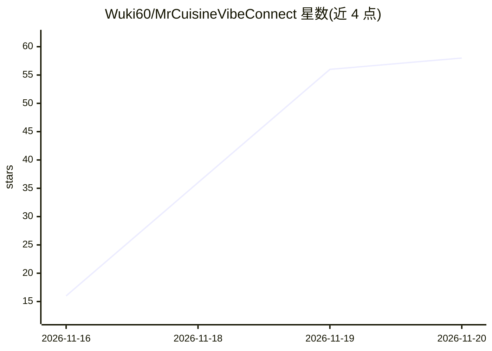

# Wuki60/MrCuisineVibeConnect

⭐ 58 · Kotlin · NOASSERTION · 推送 2026-10-25 · [GitHub](https://github.com/Wuki60/MrCuisineVibeConnect) · [官网](https://github.com/Wuki60/MrCuisineVibeConnect#readme) · 个人维护

**给 Lidl Monsieur Cuisine Connect 厨师机的替代操作界面（含 AI 代理安装向导）**

面向 Lidl Monsieur Cuisine Connect（SKMC 1200）厨师机用户的安卓替代界面应用：替换原厂 App，从 monsieur-cuisine.com 公共 API 下载约 1,700 条官方菜谱（含每步机器参数），支持引导式烹饪、称重、多语言搜索、离线运行与 GitHub 内更新。电机控制基于串行协议的公开分析（15 字节发送/27 字节接收，4800 波特），保留原厂安全限制并修复多项协议缺陷，电机控制运行于独立进程。安装可通过可操作 Windows PC 的 AI 代理（Claude、ChatGPT、Copilot 等）按 AGENTS.md 执行 PowerShell 脚本完成，需 root 设备；仅在作者的一台机器人上测试过。演示模式可在任意安卓设备或模拟器上运行。

## 筛选速览

| 维度 | 判定 | 备注 |
|---|---|---|
| AI 角色 | `ai-enhanced` | 去掉 AI 部分产品仍成立 |
| 许可风险 | `none` | NOASSERTION |
| 部署形态 | `None` |  |
| 模型依赖 | — | README 未给出锁定关系 |
| 硬件要求 | — | 无带数字的原话,不猜 |
| 安装摩擦 | `low` | 无编译、无系统依赖或容器化 |
| 成熟度 | — | 结构信号不足 |

## 能力要点

- 从官方公共 API 夜间/按需同步约 1,700 条法文菜谱，无需账号与服务器
- 引导式烹饪：单键启动逐步执行、内置称重、断电恢复、连续设置自动衔接
- 保留原厂全部安全限制并修复启动前检查、串口错误处理等协议缺陷
- AI 代理驱动的安装流程（AGENTS.md + toque-setup.ps1，含备份/root/ADB）

## 适用场景

- 替换 Monsieur Cuisine Connect 原厂界面并获得离线可用体验
- 按食材搜索官方菜谱并跟随引导式烹饪流程
- 让 AI 代理代为完成厨机的 root 与安装流程

## 场景标签

`GUI 自动化` · 领域:效率与自动化

## 证据(README 行号)

> L5: **Toque** is a fast, modern replacement interface for the Lidl **Monsieur Cuisine Connect**
> L19: The easiest way: let an AI agent that can operate your Windows PC (Claude, ChatGPT, Copilot…) do

## 星数曲线

2026-11-16 16 → 2026-11-20 58（+42）

---
*卡片 v1 · prompt 1.4 · 生成 2026-11-18 · 置信度 high · 依据 README sha `37f4cc64bc91` · [字段定义](../../DATASET.md)*
