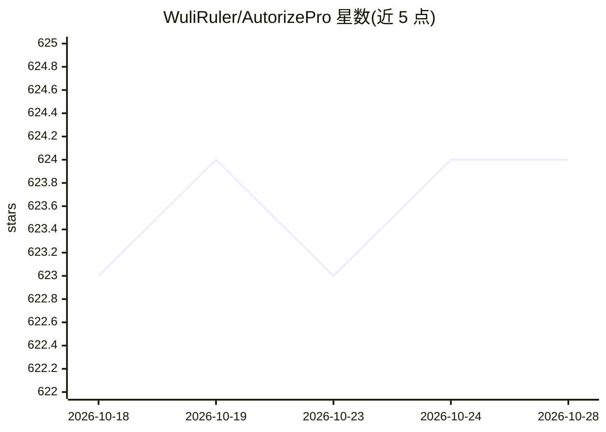

# WuliRuler/AutorizePro

⭐ 624 · Python · Apache-2.0 · 推送 2026-01-18 · [GitHub](https://github.com/WuliRuler/AutorizePro) · 个人维护 · 中文 README

**内置 AI 分析的 Burp 越权检测插件，降低误报**

基于 Autorize 插件开发的 Burp Suite 越权检测扩展：替换 cookie/参数重放请求，自动判定越权状态（Bypassed/Enforced/无法判断），支持拦截过滤规则与 html/csv 报告导出。AI 分析为可选项：对状态码相等且为 json 格式（长度 50-6000）的响应调用 OpenAI 兼容 API 判定，可配置任意自定义端点（如 Ollama 本地模型 http://localhost:11434/v1/chat/completions）或企业内部模型。安装需 Burp Suite 加 Jython standalone JAR，以 Python 扩展方式加载 AutorizePro.py。面向白帽/SRC 挖掘用户。

## 筛选速览

| 维度 | 判定 | 备注 |
|---|---|---|
| AI 角色 | `ai-enhanced` | 去掉 AI 部分产品仍成立 |
| 许可风险 | `permissive` | Apache-2.0 |
| 部署形态 | `None` |  |
| 模型依赖 | local-ok | 支持本地模型 |
| 硬件要求 | — | 无带数字的原话,不猜 |
| 安装摩擦 | `medium` | 含编译或系统依赖之一 |
| 成熟度 | — | 结构信号不足 |

## 能力要点

- 越权/未授权双重放检测，AI 判定原因可在日志中查看
- 支持任意 OpenAI 兼容自定义 API，可接本地 Ollama 或企业内部模型
- 默认排除静态资源/html/错误状态码等非接口资源
- 支持 html/csv 越权测试报告导出

## 适用场景

- 黑盒测试与 SRC 挖掘中自动化检测越权漏洞
- 用本地或企业内部模型分析响应，数据不出网
- 导出越权测试报告供复盘

## 场景标签

`网络安全` · 领域:学习与行业

## 证据(README 行号)

> L7: > **🟣️ 未启用 AI 时为常规检测逻辑，AI 为可选项。面对复杂多变的接口响应，启用 AI 可以大幅提升效率与准确率。时间宝贵，让 AI 替你十倍速挖洞！**
> L16: - **🌟 支持自定义 API：可配置任意 OpenAI 兼容的 API 端点，支持本地部署模型（如 Ollama）或其他厂商模型**

## 星数曲线

2026-10-18 623 → 2026-10-28 624（+1）

---
*卡片 v1 · prompt 1.4 · 生成 2026-10-21 · 置信度 high · 依据 README sha `81b4dcf9d7c5` · [字段定义](../../DATASET.md)*
