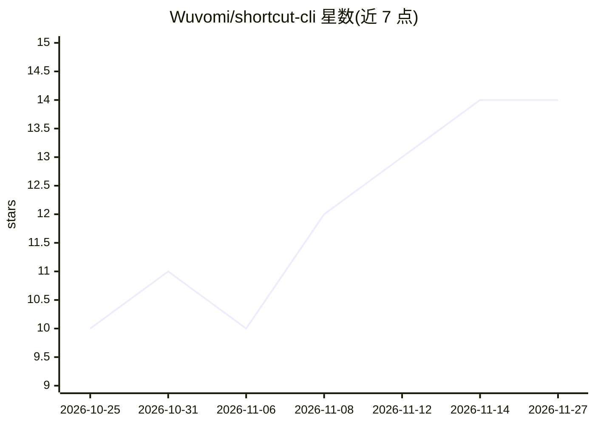

# Wuvomi/shortcut-cli

⭐ 14 · Python · MIT · 推送 2026-07-13 · [GitHub](https://github.com/Wuvomi/shortcut-cli) · 个人维护 · 中文 README

**给 AI 生成/编辑 iOS 快捷指令用的无损格式转换 CLI**

命令行工具，在 JSON 命令格式与 iOS/macOS `.shortcut` 文件间双向转换：compile 将 JSON 编译为可导入的快捷指令并默认签名，decompile 将签名或未签名文件还原为可编辑 JSON 或伪代码，另支持从 iCloud 分享链接下载及直接调起导入对话框。核心机制是把 UUID/GroupingIdentifier 规范化到 WFWorkflowActionParameters 内，避免导入器静默丢弃控制流块，并通过 decompile→compile→sign→verify 全回环验证动作数不变。签名/解码依赖 Apple 服务，仅 macOS 可用；无签名编译与 fetch 跨平台。

## 筛选速览

| 维度 | 判定 | 备注 |
|---|---|---|
| AI 角色 | `ai-enhanced` | 去掉 AI 部分产品仍成立 |
| 许可风险 | `permissive` | MIT |
| 部署形态 | `desktop` | 安装包/桌面程序 |
| 模型依赖 | — | README 未给出锁定关系 |
| 硬件要求 | — | 无带数字的原话,不猜 |
| 安装摩擦 | `low` | 无编译、无系统依赖或容器化 |
| 成熟度 | — | 结构信号不足 |

## 能力要点

- JSON ↔ .shortcut 双向转换，声称动作 100% 保留的回环
- compile 默认签名，无需付费开发者账号（使用 iCloud 签名服务）
- 自动规范化结构修复导入截断问题，info 命令可检测非规范文件
- decompile 支持解密 Apple Encrypted Archive 的已签名文件

## 适用场景

- 让 Claude/Codex 等 AI 生成的快捷指令导入后不丢动作
- 把现有快捷指令反编译为 JSON 后手动修改再编译
- 从 iCloud 分享链接下载快捷指令进行本地编辑

## 场景标签

 · 领域:开发者工具/自动化

## 证据(README 行号)

> L3: > **Lossless, verifiable** conversion between agent-readable commands (JSON) and iOS/macOS Shortcuts (`.shortcut`) —
> L15: - **Command → Shortcut** (`compile`): turn a JSON spec into a real, importable `.shortcut` — **signed by default**.
> L24: If you've ever asked **Claude, ChatGPT, Codex, Gemini, Copilot, Cursor, or any AI coding agent to generate an iOS S

## 星数曲线

2026-10-25 10 → 2026-11-27 14（+4）

---
*卡片 v1 · prompt 1.4 · 生成 2026-11-18 · 置信度 high · 依据 README sha `c1340319fe44` · [字段定义](../../DATASET.md)*
