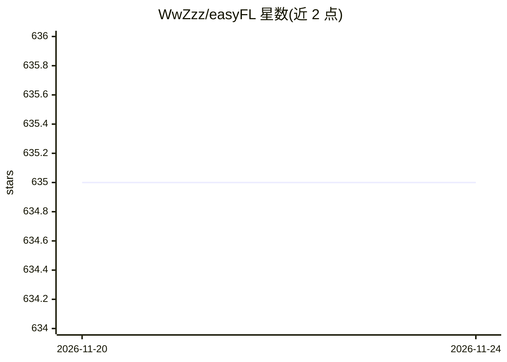

# WwZzz/easyFL

⭐ 635 · Jupyter Notebook · Apache-2.0 · 推送 2026-10-20 · [GitHub](https://github.com/WwZzz/easyFL) · 个人维护 · 中文 README

**联邦学习科研实验框架：生成任务、跑算法、复现论文**

FLGo 是用于开展联邦学习实验的 Python 库：通过内置基准生成带特定数据分布的联邦任务，配合可自定义的 Simulator 模拟客户端不可用、响应慢、连接丢失、上传不完整等系统异构行为。内置 50+ 基准（覆盖 CV/NLP/图/推荐/时序/表格等）与 50+ 来自顶会期刊的算法实现（含经典、个性化、公平性、异步、采样与容量异构等类别），基准、划分器、算法、模拟器之间可像插件一样组合，训练结果自动存为 record 并提供内置 analyzer 读取。以 pip 包和 git 源码两种方式分发，另支持部署到多台真实机器。

## 筛选速览

| 维度 | 判定 | 备注 |
|---|---|---|
| AI 角色 | `ai-native` | 本体是模型或模型工具 |
| 许可风险 | `permissive` | Apache-2.0 |
| 部署形态 | `library` | 以包/库形式分发 |
| 模型依赖 | — | README 未给出锁定关系 |
| 硬件要求 | — | 无带数字的原话,不猜 |
| 安装摩擦 | `medium` | 含编译或系统依赖之一 |
| 成熟度 | — | 结构信号不足 |

## 能力要点

- 50+ 内置基准覆盖 CV/NLP/图/推荐/时序/表格等数据类型
- 50+ 顶会期刊算法实现（FedAvg/FedProx/Ditto/FedRolex 等）
- Simulator 可自定义模拟客户端不可用、慢响应、丢连接等系统异构
- 基准/划分器/算法/模拟器四类组件可插件式自由组合

## 适用场景

- 为联邦学习论文实验生成不同数据分布的联邦任务
- 复现顶会论文中的联邦学习算法并与基线对比
- 模拟客户端掉线、慢响应等真实系统异构场景评估算法
- 将联邦学习流程扩展部署到多台真实机器

## 场景标签

`科研工具` · 领域:学习与行业

## 证据(README 行号)

> L8: FLGo is a library to conduct experiments about Federated Learning (FL). It is strong and reusable for research on FL
> L191: ## Reproduction of Algorithms from TOP-tiers and Journals :1st_place_medal:
> L274: FLGo supports flexible combinations of benchmarks, partitioners, algorithms and simulators , which are independent

## 星数曲线

2026-11-20 635 → 2026-11-24 635（+0）

---
*卡片 v1 · prompt 1.4 · 生成 2026-11-20 · 置信度 high · 依据 README sha `766c519695fc` · [字段定义](../../DATASET.md)*
