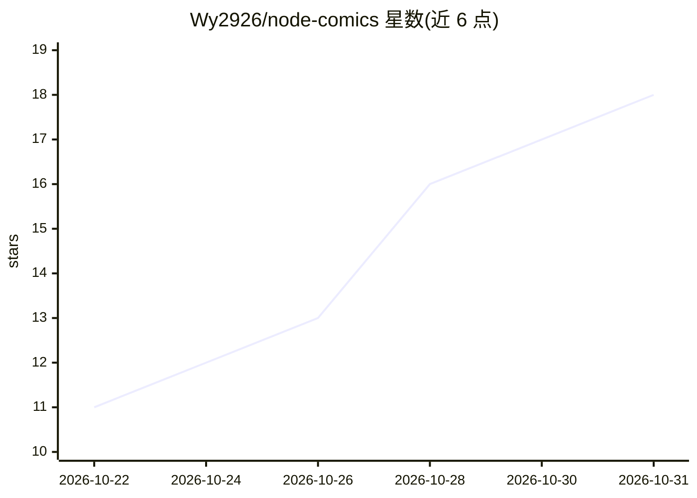

# Wy2926/node-comics

⭐ 18 · TypeScript · GPL-3.0 · 推送 2026-10-30 · [GitHub](https://github.com/Wy2926/node-comics) · [官网](https://comics.nodelane.net/) · 组织维护 · 中文 README

**带 AI 图片翻译的漫画阅读浏览器插件**

适用于 Chrome、Edge、Firefox 的漫画阅读浏览器插件（NodeLane 漫译）：支持导入本地文件、Google Drive、OPDS 书库与已适配网站漫画进书架，提供漫画发现与搜索、离线缓存续读、多种阅读模式。翻译功能支持浏览器本地翻译（Beta，下载模型后无需部署服务，图片留本机、文字发送所选翻译服务）、官方翻译服务或自建 manga-translator-ui，可原图译图对照。代码采用 GPL-3.0-only，另含后端、计算节点、图像引擎（检测/OCR/LaMa 抹字嵌字）等模块。

## 筛选速览

| 维度 | 判定 | 备注 |
|---|---|---|
| AI 角色 | `ai-enhanced` | 去掉 AI 部分产品仍成立 |
| 许可风险 | `viral` | GPL-3.0 |
| 部署形态 | `None` |  |
| 模型依赖 | — | README 未给出锁定关系 |
| 硬件要求 | — | 无带数字的原话,不猜 |
| 安装摩擦 | `low` | 无编译、无系统依赖或容器化 |
| 成熟度 | `idea` | |

## 能力要点

- 浏览器本地翻译（Beta）：下载模型即可用，无需部署服务，图片留在本机
- 支持本地文件、Google Drive、OPDS 与已适配网站导入
- 原图与译图并排对照，保留阅读位置
- 离线缓存网站漫画章节，可暂停续读

## 适用场景

- 在浏览器里统一管理并阅读各来源的漫画
- 阅读外文漫画时即时翻译图片并与原图对照
- 缓存章节后离线续读

## 场景标签

 · 领域:漫画阅读/图片翻译工具

## 证据(README 行号)

> L13: 适用于 Chrome、Edge、Firefox。把本地文件、Google Drive 和已适配网站的漫画放进书架，边看边译，随时对照原图。
> L15: 在设置中选择「浏览器本地翻译（Beta）」，下载模型和字体后即可使用，无需部署服务。图片留在本机，识别文字发送到所选翻译服务；也可使用官方翻译或连接自建 manga-translator-ui。
> L22: - **随读随译**：在阅读器或网页中翻译图片，切回原图或并排对照，保留阅读位置。

## 星数曲线

2026-10-22 11 → 2026-10-31 18（+7）

---
*卡片 v1 · prompt 1.4 · 生成 2026-10-30 · 置信度 mid · 依据 README sha `5b6ec94ad1ea` · [字段定义](../../DATASET.md)*
