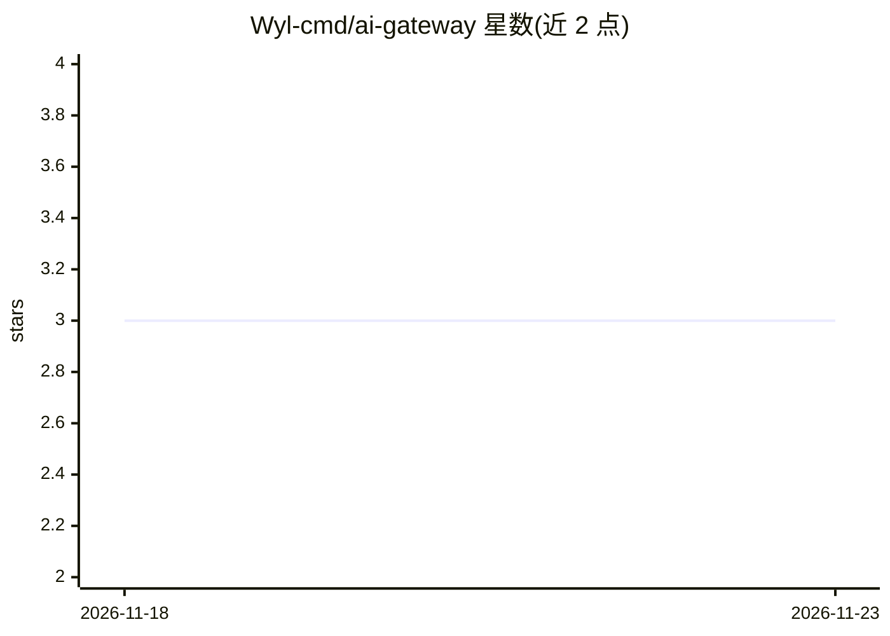

# Wyl-cmd/ai-gateway

⭐ 3 · Python · AGPL-3.0 · 推送 2026-11-16 · [GitHub](https://github.com/Wyl-cmd/ai-gateway) · 个人维护 · 中文 README

**本地自用的 LLM 路由网关：统一入口、多账号熔断与提示阶梯**

以本地进程/GUI 形式运行的 AI 网关：对外提供 OpenAI 与 Anthropic 双协议端点，内部完成路由选择、多账号池管理、配额降级与请求透传。核心机制包含 27 种技术 × 4 级阶梯的破甲模块（内置 39 条厂商模板）、按「模型 × 技术」成功率排序的有效性记忆，以及 route_trace 可解释路由。支持 Windows 免安装 exe 与 pip 源码安装，密钥保存在本机 secrets.toml。

## 筛选速览

| 维度 | 判定 | 备注 |
|---|---|---|
| AI 角色 | `ai-ecosystem` | LLM/agent 周边工具 |
| 许可风险 | `viral` | AGPL-3.0 |
| 部署形态 | `desktop` | 安装包/桌面程序 |
| 模型依赖 | — | README 未给出锁定关系 |
| 硬件要求 | — | 无带数字的原话,不猜 |
| 安装摩擦 | `low` | 无编译、无系统依赖或容器化 |
| 成熟度 | `idea` | |

## 能力要点

- OpenAI /v1/chat/completions 与 Anthropic /v1/messages 双协议同时在线
- 破甲模块：27 种技术 × 4 级阶梯，含 39 条厂商专用模板
- 多账号池熔断：配额耗尽跳过单账号，服务故障跳过整个 provider
- route_trace 返回候选集、排除原因与决策依据

## 适用场景

- 为多个客户端应用提供统一的本地 LLM 接入入口
- 管理同一供应商的多个 API Key 池并自动降级
- 在 OpenAI 与 Anthropic 客户端 SDK 间复用同一批上游配置

## 场景标签

`模型网关` · 领域:Agent 开发

## 证据(README 行号)

> L1: # AI Gateway —— AI 路由一站式网关
> L3: > 自用的本地 AI 网关：**统一入口 + 自动破甲 + 智能路由 + 多账号熔断**。
> L89: ① 接入层    OpenAI / Anthropic 双协议同时在线（URL 定格式，协议分流）

## 星数曲线

2026-11-18 3 → 2026-11-23 3（+0）

---
*卡片 v1 · prompt 1.4 · 生成 2026-11-22 · 置信度 high · 依据 README sha `ea2394af2ee8` · [字段定义](../../DATASET.md)*
