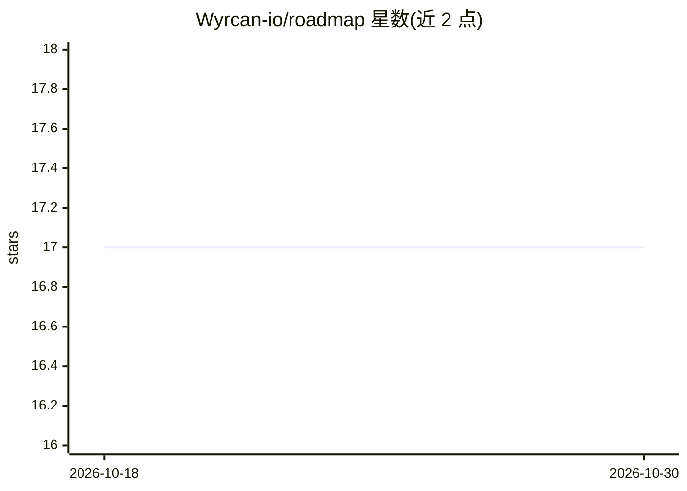

# Wyrcan-io/roadmap

⭐ 17 · HTML · 推送 2026-09-10 · [GitHub](https://github.com/Wyrcan-io/roadmap) · [官网](https://wyrcan-io.github.io/roadmap/) · 个人维护

**AI/ML×云×DevOps×MLOps 12 阶段工程师学习路线图（12-24 个月）**

文本优先的工程学习课程目录：12 个阶段覆盖 Python/Linux 基础、Docker、AWS、CI/CD、Terraform、经典 ML、PyTorch、MLOps、Kubernetes、可观测性与毕设。资料仅取 4 本教材（ISLP/UDL/DDIA/OSTEP）与官方文档、大学课程，含 110 个检查点，提供 24 个月在职与 12 个月全职两条进度轨道，要求围绕单一生产级 AI 平台持续构建并撰写故障复盘。配 GitHub Pages 交互清单站点，本地浏览器存储进度。

## 筛选速览

| 维度 | 判定 | 备注 |
|---|---|---|
| AI 角色 | `ai-knowledge` | 知识聚合/清单类 |
| 许可风险 | `none` | — |
| 部署形态 | `self-host` | docker 或自建部署 |
| 模型依赖 | — | README 未给出锁定关系 |
| 硬件要求 | — | 无带数字的原话,不猜 |
| 安装摩擦 | `low` | 无编译、无系统依赖或容器化 |
| 成熟度 | — | 结构信号不足 |

## 能力要点

- 12 阶段课程表含每阶段交付物与节奏（110 检查点）
- 资料限定为经典教材与官方文档/大学课程，不含视频教程
- 24 个月在职与 12 个月全职双进度轨道
- 在线站点提供大纲追踪、进度导出 Markdown 与搜索过滤

## 适用场景

- 按阶段自学 AI/ML 与云/DevOps/MLOps 工程能力
- 在职工程师用 2 年轨道规划每周学习节奏
- 把学习进度导出到 Notion/Obsidian 做记录

## 场景标签

`教程课程` · 领域:学习与行业

## 证据(README 行号)

> L1: # AI/ML × Cloud × DevOps × MLOps — 12-Stage Practitioner Roadmap (12–24 Months)
> L3: > **A practitioner-verified, text-first engineering curriculum (12–24 Months) grounded entirely in official vendor d
> L36: ## The 12-Stage Curriculum Overview

## 星数曲线

2026-10-18 17 → 2026-10-30 17（+0）

---
*卡片 v1 · prompt 1.4 · 生成 2026-10-29 · 置信度 mid · 依据 README sha `c4807b1e70e0` · [字段定义](../../DATASET.md)*
