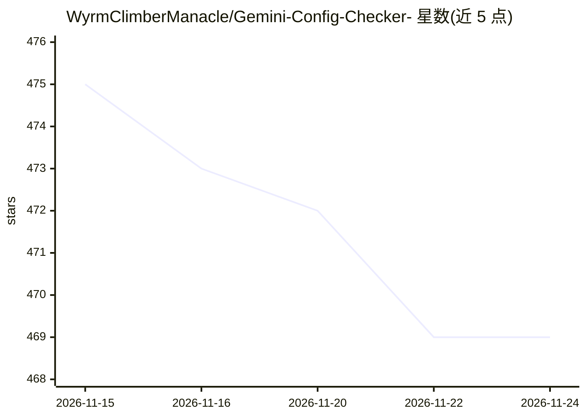

# WyrmClimberManacle/Gemini-Config-Checker-

⭐ 469 · Makefile · Apache-2.0 · 推送 2026-11-15 · [GitHub](https://github.com/WyrmClimberManacle/Gemini-Config-Checker-) · 个人维护

**扫描代理配置能否进入 Google AI Studio 与 Gemini 的桌面/CLI 工具**

面向需要通过代理访问 Google AI Studio 与 Gemini 的用户：在登录态浏览器中逐个测试代理配置（vless/vmess/trojan/ss、订阅链接或 base64），读取 Google 对登录账号的区域判定结果；Advanced 模式可将免费配置串接在已有的 base 配置之后以更换出口。内嵌 Xray-core 引擎，提供可编辑的 anti-DPI 分片配置，并导出链接、base64 或 Xray 配置。提供 Windows/macOS/Linux 桌面与 Android APK 构建及 web server 模式；macOS/Linux/Android 构建未经真机验证，处于 0.1.0 早期预发布阶段。

## 筛选速览

| 维度 | 判定 | 备注 |
|---|---|---|
| AI 角色 | `ai-enhanced` | 去掉 AI 部分产品仍成立 |
| 许可风险 | `permissive` | Apache-2.0 |
| 部署形态 | `desktop` | 安装包/桌面程序 |
| 模型依赖 | — | README 未给出锁定关系 |
| 硬件要求 | — | 无带数字的原话,不猜 |
| 安装摩擦 | `medium` | 含编译或系统依赖之一 |
| 成熟度 | `idea` | |

## 能力要点

- Simple/Advanced 双模式：批量测试自有配置或 base→free 链式出口
- 登录态浏览器区域检测（AI Studio 与 Gemini 分别判定）与仅连通性检测两种模式
- 可编辑的 anti-DPI 分片配置（Finalmask/指纹/ALPN/密码套件），本地转发器实现 per-segment 分片
- 导出链接、base64 及完整/链式 Xray 配置

## 适用场景

- 我在受限地区，想找出哪些代理配置能真正打开 AI Studio 和 Gemini
- 我的 Cloudflare 配置能连但被 Google 拦出口，需要链式换一个可用出口
- 扫描前先验证我准备长期使用的配置当前是否可用

## 场景标签

 · 领域:网络工具/AI 服务访问

## 证据(README 行号)

> L11: Find proxy configs that actually get you into **Google AI Studio and Gemini**, by testing each one the way a person
> L50: Google decides region availability **per signed-in account, after the page has loaded**. A plain HTTP request (even
> L119: No browser installed, or on Android? Switch the *check type* (Settings) to **connectivity only**: no sign-in or br

## 星数曲线

2026-11-15 475 → 2026-11-24 469（-6）

---
*卡片 v1 · prompt 1.4 · 生成 2026-11-17 · 置信度 mid · 依据 README sha `846e83cebb20` · [字段定义](../../DATASET.md)*
