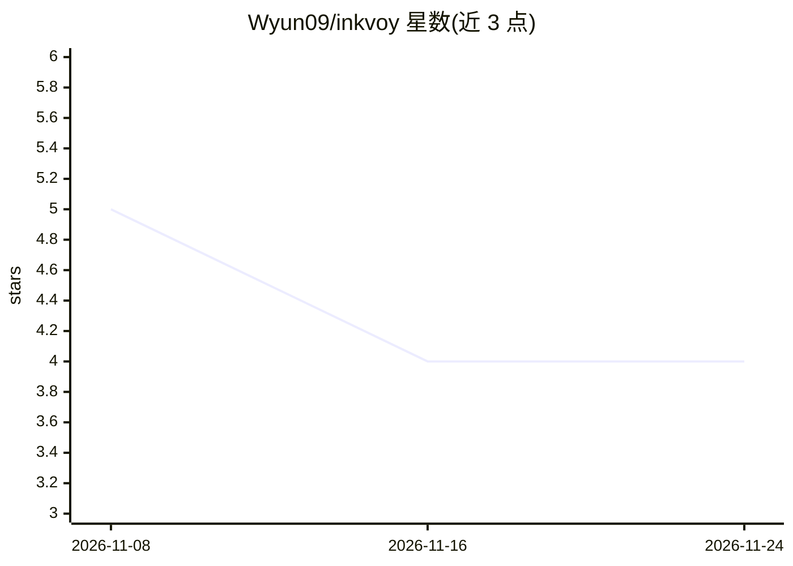

# Wyun09/inkvoy

⭐ 4 · JavaScript · GPL-3.0 · 推送 2026-11-08 · [GitHub](https://github.com/Wyun09/inkvoy) · 个人维护 · 中文 README

**在 Android 手机上运行 AI 工作台：终端/浏览器/App 交给 AI 执行**

面向编程、安全研究与逆向分析的 Android 本机 AI 工作台：模型推理走外部端点，执行端在手机本地——内置 Debian 13 ARM64 用户态终端（含 Python/Node/GCC 与 JADX、radare2 等逆向工具链）、可观察浏览器与基于无障碍服务的 App 操控。支持流式回复、工具执行链、MCP、子代理与多端点协作。源码以 GPL-3.0-only 开放，v5.5.0 安装包已作为 Release 附件发布，README 自述实体手机验收未完成。

## 筛选速览

| 维度 | 判定 | 备注 |
|---|---|---|
| AI 角色 | `ai-native` | 本体是模型或模型工具 |
| 许可风险 | `viral` | GPL-3.0 |
| 部署形态 | `None` |  |
| 模型依赖 | locked-api |  |
| 硬件要求 | — | 无带数字的原话,不猜 |
| 安装摩擦 | `high` | 编译与系统依赖俱全 |
| 成熟度 | — | 结构信号不足 |

## 能力要点

- 随包附带 Debian ARM64 终端与逆向工具链（JADX/Apktool/radare2 等）
- 可观察浏览器与基于系统无障碍服务的 App 操控，范围由用户勾选
- 支持 MCP、插件、子代理与多端点协作的流式工具执行链
- 运行环境镜像下载后按 SHA-256 校验导入

## 适用场景

- 在手机上让 AI 直接运行命令、修改项目文件并跑构建
- 安全研究与 APK 逆向分析场景下使用内置工具链
- 通过无障碍服务让 AI 操作用户显式勾选的 App

## 场景标签

`编码 Agent` `网络安全` `GUI 自动化` `浏览器自动化` · 领域:效率与自动化

## 证据(README 行号)

> L3: **Android 手机上的 AI 工作台：对话结束后，它继续把活干完。**
> L53: **模型与工具接入** — DeepSeek 网页桥、自建 OpenAI 兼容端点、ChatGPT 账号连接；MCP、插件与技能。

## 星数曲线

2026-11-08 5 → 2026-11-24 4（-1）

---
*卡片 v1 · prompt 1.4 · 生成 2026-11-21 · 置信度 high · 依据 README sha `ccee2afa1960` · [字段定义](../../DATASET.md)*
