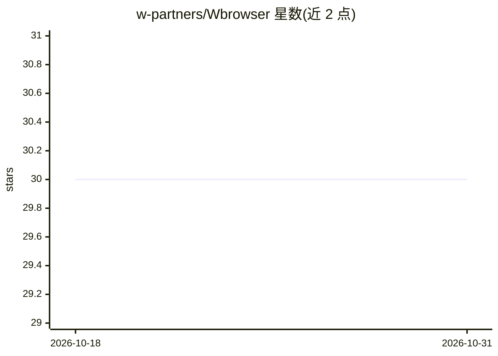

# w-partners/Wbrowser

⭐ 30 · JavaScript · MIT · 推送 2026-10-12 · [GitHub](https://github.com/w-partners/Wbrowser) · 组织维护 · 中文 README

**让 AI 助手驱动你已登录 Chrome 的 CLI/MCP 工具**

面向使用 AI 助手的用户的浏览器自动化工具：在用户手动登录一次的专用 Chrome 配置中，通过终端命令或 MCP 让 agent 在独立标签页中浏览、读取和点击已登录站点，agent 不接触密码。提供 AES-256-GCM 本地加密密码库（仅引擎读取）、`wb take` 手动移交标签页、无人值守任务拒绝提交/支付/删除类操作等机制。以脚本安装（curl/setup.sh）或 git clone + npm 方式部署，注册为本地 stdio MCP 服务器，支持 Windows/macOS/Linux/WSL。

## 筛选速览

| 维度 | 判定 | 备注 |
|---|---|---|
| AI 角色 | `ai-ecosystem` | LLM/agent 周边工具 |
| 许可风险 | `permissive` | MIT |
| 部署形态 | `library` | 以包/库形式分发 |
| 模型依赖 | — | README 未给出锁定关系 |
| 硬件要求 | — | 无带数字的原话,不猜 |
| 安装摩擦 | `low` | 无编译、无系统依赖或容器化 |
| 成熟度 | — | 结构信号不足 |

## 能力要点

- 驱动用户已登录的系统 Chrome，非 headless 新浏览器、不复制配置文件
- 本地 stdio MCP 注册，agent 以独立标签页操作且不接收密码/cookie 值
- AES-256-GCM 加密密码库，仅引擎读取，AI 不可见
- `wb take <#>` 将用户当前标签页移交给 agent 接续操作

## 适用场景

- 让 AI 助手访问登录墙后的邮箱、看板和内部系统
- 把繁琐到一半的页面交给 agent 从当前状态继续
- 通过终端命令驱动自己已登录的 Chrome 完成自动化

## 场景标签

`浏览器自动化` · 领域:效率与自动化

## 证据(README 行号)

> L196: It checks what you have, clones, installs, puts `wb` on your PATH, installs the agent
> L197: skill **and registers wbrowser as an MCP server** so your assistant both knows the tool
> L101: After that, your terminal (or your AI assistant) can drive that exact window — already

## 星数曲线

2026-10-18 30 → 2026-10-31 30（+0）

---
*卡片 v1 · prompt 1.4 · 生成 2026-10-26 · 置信度 high · 依据 README sha `a2fa0d01eb3e` · [字段定义](../../DATASET.md)*
