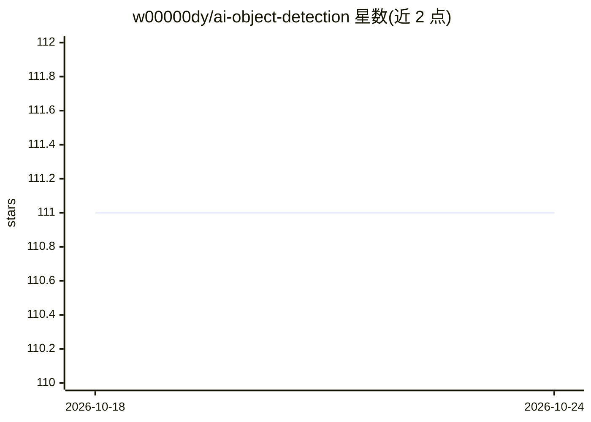

# w00000dy/ai-object-detection

⭐ 111 · JavaScript · 推送 2026-03-08 · [GitHub](https://github.com/w00000dy/ai-object-detection) · [官网](https://object-detection.ai.woody.pizza/) · 个人维护

**浏览器内运行的网页 AI 物体检测应用**

基于网页浏览器的 AI 物体检测应用：调用设备摄像头，在浏览器中实时检测画面中的物体。提供开关切换 AI 检测、滑块调节帧率两项控制功能。技术栈含 ml5js 与 Materialize，支持桌面与移动端主流浏览器（Firefox/Chrome/Edge，不支持 IE），并提供在线演示地址。以纯静态网页形式运行，无需本地安装。

## 筛选速览

| 维度 | 判定 | 备注 |
|---|---|---|
| AI 角色 | `ai-native` | 本体是模型或模型工具 |
| 许可风险 | `none` | — |
| 部署形态 | `None` |  |
| 模型依赖 | — | README 未给出锁定关系 |
| 硬件要求 | — | 无带数字的原话,不猜 |
| 安装摩擦 | `low` | 无编译、无系统依赖或容器化 |
| 成熟度 | — | 结构信号不足 |

## 能力要点

- 调用设备摄像头在浏览器中检测物体
- 开关切换 AI 与滑块控制帧率
- 桌面与移动端多浏览器支持（IE 不支持）

## 适用场景

- 在浏览器里用摄像头实时检测物体
- 无需安装即可在线体验 AI 检测效果

## 场景标签

`目标检测` · 领域:感知与多模态

## 证据(README 行号)

> L3: This is a web AI object detection. You can use it in your web browser. This web application uses the camera of your 
> L33: - ml5js

## 星数曲线

2026-10-18 111 → 2026-10-24 111（+0）

---
*卡片 v1 · prompt 1.4 · 生成 2026-10-23 · 置信度 high · 依据 README sha `75fa97ccf56b` · [字段定义](../../DATASET.md)*
