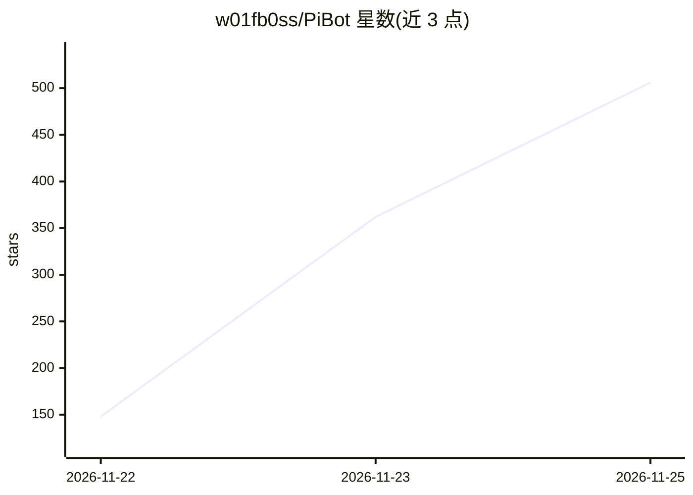

# w01fb0ss/PiBot

⭐ 506 · TypeScript · Apache-2.0 · 推送 2026-11-23 · [GitHub](https://github.com/w01fb0ss/PiBot) · [官网](https://pibot.space) · 个人维护 · 中文 README

**桌面端本地优先的多 Bot 协作 AI agent 团队应用**

桌面应用：可创建多个具名 Bot（含角色、模型、技能、权限、记忆），支持单聊与群聊，群内有协调者分派任务；Bot 在指定工作目录中规划、执行命令、编辑文件、浏览网页，所有风险操作经审批策略引擎并写入审计日志，命令在沙箱中运行。数据本地保存，仅所选模型提供方可见提示词。提供安装包下载，亦可 Node+pnpm 从源码构建，另含 Android 应用。

## 筛选速览

| 维度 | 判定 | 备注 |
|---|---|---|
| AI 角色 | `ai-native` | 本体是模型或模型工具 |
| 许可风险 | `permissive` | Apache-2.0 |
| 部署形态 | `library` | 以包/库形式分发 |
| 模型依赖 | local-ok | 支持本地模型 |
| 硬件要求 | — | 无带数字的原话,不猜 |
| 安装摩擦 | `low` | 无编译、无系统依赖或容器化 |
| 成熟度 | — | 结构信号不足 |

## 能力要点

- 多 Bot 单聊/群聊协作，协调者规划并分发任务，执行前需用户确认
- 统一审批策略引擎与沙箱命令执行，附带审计日志
- 支持本地模型（Ollama）、OpenRouter、自有 API key 及订阅登录
- 定时、文件夹触发与连接触发的例程任务；可接 MCP 服务器与知识库

## 适用场景

- 在本机让多个 Bot 分工协作完成开发、写作等任务
- 需要每步操作人工审批的可控 agent 自动化
- 使用本地模型保持聊天与文件不出本机
- 通过手机 App 或自托管中继扩展多设备使用

## 场景标签

`多智能体` `AI 助手` `编码 Agent` `GUI 自动化` · 领域:Agent 开发

## 证据(README 行号)

> L3: **An open-source, local-first AI agent team for your desktop.** Named AI Bots work on your own
> L21: Pi Bot is a desktop app in which a team of named Bots works on your own computer. You chat with a
> L42: - **Models.** Local models through Ollama, OpenRouter, your own API keys, and supported

## 星数曲线

2026-11-22 148 → 2026-11-25 506（+358）

---
*卡片 v1 · prompt 1.4 · 生成 2026-11-25 · 置信度 high · 依据 README sha `abd5a2e51de0` · [字段定义](../../DATASET.md)*
