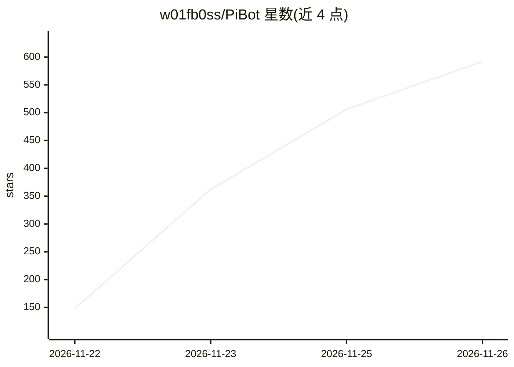

# w01fb0ss/PiBot

⭐ 592 · TypeScript · Apache-2.0 · 推送 2026-11-25 · [GitHub](https://github.com/w01fb0ss/PiBot) · [官网](https://pibot.space) · 个人维护

**本地优先的桌面多 Agent 团队协作应用**

基于 pi agent 内核构建的 Electron 桌面应用，用户创建多个具名 Bot（可设角色、模型、技能、权限与记忆），支持单聊与群聊协作，由协调者规划并分发任务。Bot 在指定工作目录内执行命令、编辑文件、浏览网页，所有工具调用经过统一策略引擎并在沙箱中运行，风险步骤需用户审批且写入审计日志。支持定时/触发式任务、MCP 服务器、知识库连接，本地模型经 Ollama 接入。聊天、文件与密钥保留本地，无遥测。提供 macOS/Windows/Linux 安装包与 Android 应用，也可从源码构建。

## 筛选速览

| 维度 | 判定 | 备注 |
|---|---|---|
| AI 角色 | `ai-native` | 本体是模型或模型工具 |
| 许可风险 | `permissive` | Apache-2.0 |
| 部署形态 | `library` | 以包/库形式分发 |
| 模型依赖 | local-ok | 支持本地模型 |
| 硬件要求 | — | 无带数字的原话,不猜 |
| 安装摩擦 | `low` | 无编译、无系统依赖或容器化 |
| 成熟度 | — | 结构信号不足 |

## 能力要点

- 多 Bot 群聊协作，含任务规划与结果汇总的协调机制
- 统一策略引擎审批工具调用，命令沙箱执行并记录审计日志
- 本地优先：聊天、文件、记忆与密钥留存在本机，无遥测
- 支持 Ollama 本地模型、OpenRouter、自有 API key 与订阅登录

## 适用场景

- 让多个 Bot 在本地文件夹分工完成开发与研究任务
- 需要每一步风险操作可审批、可审计的自动化执行
- 通过 Ollama 使用本地模型保持数据不出本机
- 用定时与文件夹触发任务自动化例行工作

## 场景标签

`多智能体` `AI 助手` `编码 Agent` · 领域:Agent 开发

## 证据(README 行号)

> L21: Pi Bot is a desktop app in which a team of named Bots works on your own computer. You chat with a
> L42: - **Models.** Local models through Ollama, OpenRouter, your own API keys, and supported
> L37: - **Approvals and permissions.** Every tool call goes through one policy engine. Commands run in

## 星数曲线

2026-11-22 148 → 2026-11-26 592（+444）

---
*卡片 v1 · prompt 1.4 · 生成 2026-11-26 · 置信度 mid · 依据 README sha `2a2e1d4c3fd4` · [字段定义](../../DATASET.md)*
