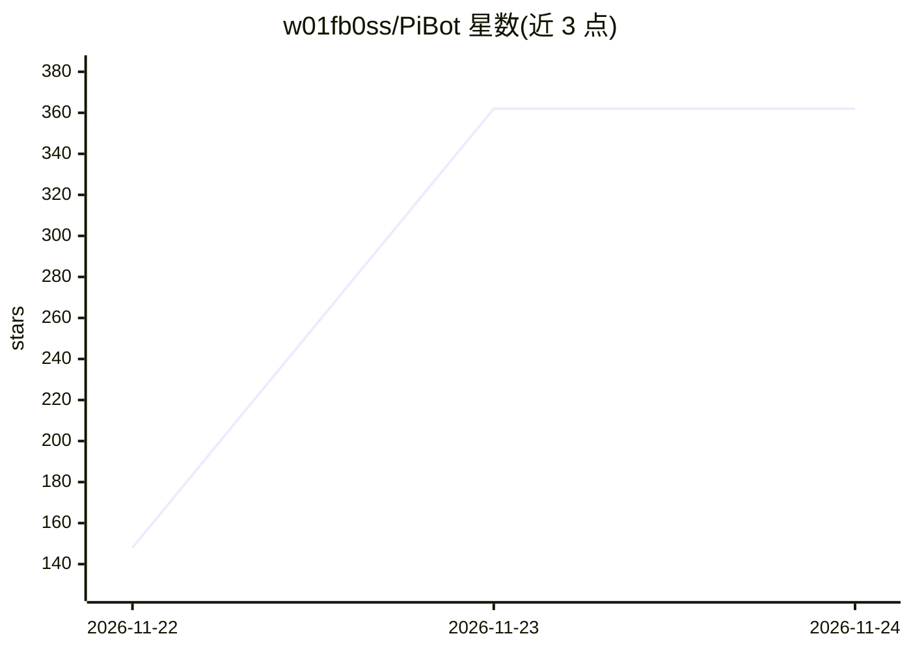

# w01fb0ss/PiBot

⭐ 362 · TypeScript · Apache-2.0 · 推送 2026-11-22 · [GitHub](https://github.com/w01fb0ss/PiBot) · [官网](https://pibot.space) · 个人维护 · 中文 README

**桌面本地优先的多 Bot 协作 AI 代理应用**

基于 Electron 的桌面应用，运行于 pi agent 内核之上：用户创建带名称、角色、模型、技能与权限的多个 Bot，可单聊或群聊，群内由协调者规划并把步骤分派给成员；Bot 在指定工作目录内执行命令、编辑文件、浏览网页，每个高风险步骤需用户审批，并经沙箱运行、写入审计日志。支持定时/触发式例程、MCP 服务器与知识库连接。聊天、文件、内存与密钥保留本地。提供 macOS/Windows/Linux 安装包及 Android 应用，支持从源码构建。

## 筛选速览

| 维度 | 判定 | 备注 |
|---|---|---|
| AI 角色 | `ai-native` | 本体是模型或模型工具 |
| 许可风险 | `permissive` | Apache-2.0 |
| 部署形态 | `library` | 以包/库形式分发 |
| 模型依赖 | local-ok | 支持本地模型 |
| 硬件要求 | — | 无带数字的原话,不猜 |
| 安装摩擦 | `low` | 无编译、无系统依赖或容器化 |
| 成熟度 | — | 结构信号不足 |

## 能力要点

- 多 Bot 群聊协作：协调者规划、分派步骤并汇总结果，执行前需用户确认
- 统一策略引擎审批所有工具调用，命令在沙箱中运行并记录审计日志
- 本地优先：聊天、文件、内存与密钥保留在本机，无遥测
- 支持本地模型（Ollama）、OpenRouter、自有 API key 与订阅登录

## 适用场景

- 让多个分工不同的 Bot 在群聊中协作完成开发、调研或写作任务
- 在本地文件夹内让 Bot 自动执行命令和编辑文件，同时逐项审批
- 配置定时或文件夹触发的自动化例程

## 场景标签

`多智能体` `AI 助手` · 领域:Agent 开发

## 证据(README 行号)

> L3: **An open-source, local-first AI agent team for your desktop.** Named AI Bots work on your own
> L20: Pi Bot is a desktop app in which a team of named Bots works on your own computer. You chat with a
> L41: - **Models.** Local models through Ollama, OpenRouter, your own API keys, and supported

## 星数曲线

2026-11-22 148 → 2026-11-24 362（+214）

---
*卡片 v1 · prompt 1.4 · 生成 2026-11-22 · 置信度 high · 依据 README sha `757e82c46f31` · [字段定义](../../DATASET.md)*
