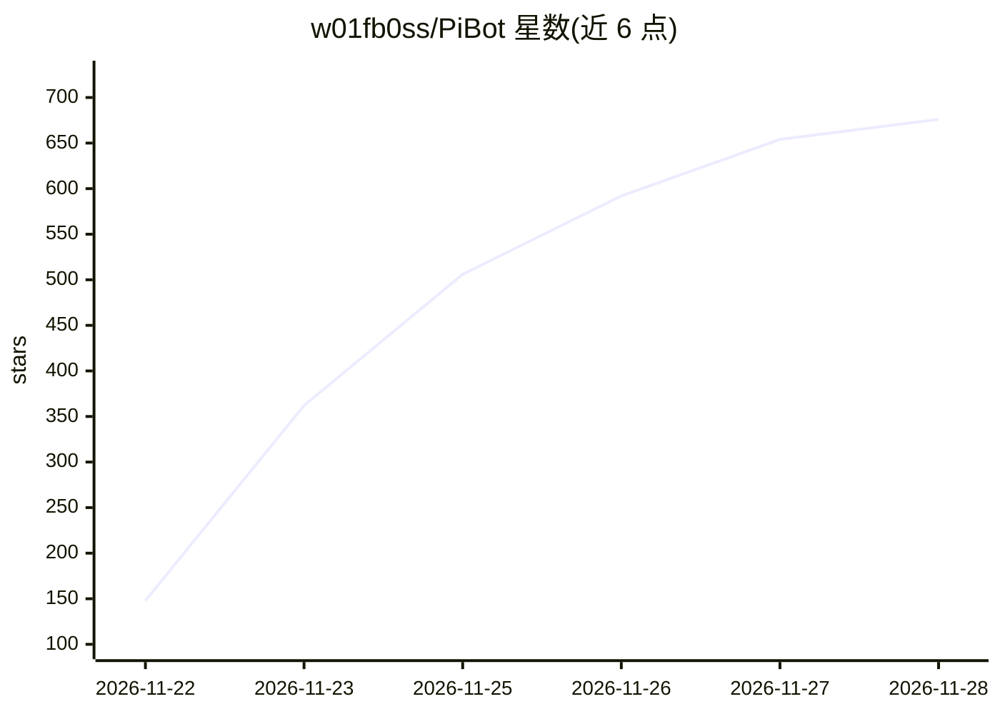

# w01fb0ss/PiBot

⭐ 676 · TypeScript · Apache-2.0 · 推送 2026-11-27 · [GitHub](https://github.com/w01fb0ss/PiBot) · [官网](https://pibot.space) · 个人维护

**本地优先的桌面多 Agent 团队应用：协作执行并需审批**

Electron 桌面应用，内含多个具名 Bot 组成的团队：可单聊或群聊，Bot 能规划任务、运行命令、编辑文件、浏览网页和操作电脑，每个高风险步骤需用户审批。群聊设有协调者负责分工与汇总。数据（聊天、文件、记忆、密钥）保存在本地，仅所选模型提供商可见提示词。支持定时/触发式任务、MCP 连接、审计日志与沙箱执行；提供 Android 应用与自托管 relay。安装方式为官网下载或源码构建。

## 筛选速览

| 维度 | 判定 | 备注 |
|---|---|---|
| AI 角色 | `ai-native` | 本体是模型或模型工具 |
| 许可风险 | `permissive` | Apache-2.0 |
| 部署形态 | `library` | 以包/库形式分发 |
| 模型依赖 | local-ok | 支持本地模型 |
| 硬件要求 | — | 无带数字的原话,不猜 |
| 安装摩擦 | `low` | 无编译、无系统依赖或容器化 |
| 成熟度 | — | 结构信号不足 |

## 能力要点

- 多 Bot 群聊协作，协调者规划分工并经用户确认
- 统一策略引擎的审批机制、沙箱执行与审计日志
- 本地模型经 Ollama 接入，亦支持 OpenRouter 与自有 API key
- macOS/Windows/Linux 桌面端与 Android 应用，无遥测

## 适用场景

- 让多个 AI Bot 在本地文件夹中协作完成开发/研究/写作任务
- 定时或文件夹触发的自动化例程任务
- 通过审批机制安全地让 AI 操作电脑和浏览器

## 场景标签

`多智能体` `编码 Agent` `GUI 自动化` · 领域:Agent 开发

## 证据(README 行号)

> L3: **An open-source, local-first AI agent team for your desktop.** Named AI Bots work on your own
> L21: Pi Bot is a desktop app in which a team of named Bots works on your own computer. You chat with a
> L42: - **Models.** Local models through Ollama, OpenRouter, your own API keys, and supported

## 星数曲线

2026-11-22 148 → 2026-11-28 676（+528）

---
*卡片 v1 · prompt 1.4 · 生成 2026-11-28 · 置信度 high · 依据 README sha `0d665fc90b23` · [字段定义](../../DATASET.md)*
